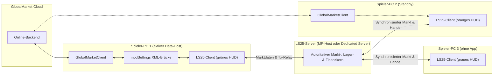

<div align="center">

# FS25_GlobalMarket

**Warenmarkt, Lieferverträge, Gebrauchtfahrzeug- & Tiermarkt für den Landwirtschafts-Simulator 25 — entwickelt für Singleplayer, Multiplayer und Dedicated Server.**


🌐 [**🇬🇧 English**](./README.md) · **Deutsch**

[**🔌 GlobalMarketClient**](https://github.com/D-S-Agrarservice/GlobalMarketClient) · [**📄 Schnittstellen-Doku**](https://github.com/D-S-Agrarservice/GlobalMarketClient/blob/main/docs/External_Interface_Specification_FS25_GlobalMarket_Mod2EXE.md)

Entwickelt von **D-S-Agrarservice [Floowy]** | Ursprüngliches Konzept & Inspiration von **kevink98**

</div>

---

### Inhaltsverzeichnis
- [Überblick](#überblick)
- [Hauptfunktionen](#hauptfunktionen)
- [Architektur & Multiplayer-Topologie](#architektur--multiplayer-topologie)
- [HUD-Statusanzeige](#hud-statusanzeige)
- [Installation & Steuerung](#installation--steuerung)
- [Modder & Mapper API](#modder--mapper-api)
- [Projektstruktur](#projektstruktur)
- [Credits, Herkunft & KI-Transparenz](#credits-herkunft--ki-transparenz)
- [Mitwirken & Support](#mitwirken--support)
- [Urheberrecht & Lizenz](#urheberrecht--lizenz)

---

### Überblick

**FS25_GlobalMarket** bringt einen eigenen Reiter ins `ESC`-Menü des Landwirtschafts-Simulators 25, der vier Handelsbereiche bündelt:

1. **Warenmarkt:** An- und Verkauf von Schüttgut, Flüssigkeiten, Paletten, BigBags, IBC-Tanks und Ballen direkt aus deinen Silos, Produktionslagern und Objektlagern — mit dynamischen Beständen, Sättigungspreisen und Großen Nachfragen.
2. **Lieferverträge & Direktangebote:** Spieler und NPC-Abnehmer schreiben Lieferverträge mit Preisaufschlag aus; Höfe und NPC-Händler verkaufen Partien zu bis zu `±10 %` des Marktpreises.
3. **Gebrauchtfahrzeugmarkt:** Eigene Fahrzeuge und Geräte zum Wunschpreis anbieten und Gebrauchte von anderen Höfen und NPC-Händlern direkt im Shop-Bildschirm des Spiels kaufen.
4. **Tiermarkt:** Tiere zwischen Höfen und NPC-Viehhändlern handeln, mit ihrem vollen Zustand — Alter, Gesundheit und Trächtigkeit — geliefert in den Stall oder mit dem eigenen Viehanhänger beim Viehhändler abgeholt; zum Festpreis oder als Auktion.

Alles funktioniert **sofort** mit einem simulierten Offline-Markt — ohne externe Zusatzprogramme. Läuft parallel zum Spiel die optionale Begleit-App **[GlobalMarketClient](https://github.com/D-S-Agrarservice/GlobalMarketClient)**, verbindet sich deine Sitzung mit dem gemeinsamen Online-Markt, auf dem echte Käufe und Verkäufe anderer Spieler serverübergreifend Angebot, Preistrends und Große Nachfragen beeinflussen.

---

### Hauptfunktionen

#### Warenmarkt & faires kartenübergreifendes Preissystem
* **Anti-Arbitrage „Map-Spy“-Preisberechnung:** Das Online-Backend gibt keine starren Euro-Festpreise vor. Stattdessen ermittelt der Mod den realen lokalen Durchschnittspreis der Verkaufsstellen auf deiner Karte (inklusive Wirtschaftsschwierigkeitsgrad und saisonaler Schwankungen) und verrechnet ihn mit dem Markttrend (`Lokaler Normalpreis × Trend`).
* **Dynamisches Angebot & Nachfrage:** Hohe Marktbestände senken den Preis (bis `-30 %`), knappe Bestände treiben ihn nach oben (bis `+30 %` und darüber hinaus bei Großen Nachfragen).
* **Große Nachfragen (Great Demands):** Einstellbare knappheitsbasierte oder zufällige Große Nachfragen im Offline-Modus sowie zentrale weltweite Kampagnen im Online-Modus — direkt angekündigt über native LS25-HUD-Meldungen.
* **Hybrider Moderations-Modus (Mod- & Map-Güter):** Erkennt automatisch alle zusätzlichen `FillTypes` deiner Karte und aktiven Mods. Offiziell freigegebene Güter laufen live über den globalen Online-Markt, während neue (`Ausstehend | Offline`) oder rein lokale (`Nur Offline`) Sondergüter unterbrechungsfrei über die lokale Offline-Simulation weitergehandelt werden.

#### Lager, Gebinde & Logistik
* **Automatische Lagererkennung:** Unterstützt Standard-Schüttgutsilos (`spec_silo`), Produktionslager sowie Objektlager (`spec_objectStorage`) für Paletten und Ballen.
* **Tiefgehende Gebinde-Auswahl:** Kaufe und verkaufe lose Liter oder physische Gebinde (Paletten, BigBags, BigBag-Paletten, IBC-Tanks, Rundballen und Quaderballen). Noch gärende Silageballen sind bis zum Ende der Fermentation automatisch vom Handel ausgeschlossen.
* **GM-Logistik-Terminals (`isGmMarket`):** Optionale Spezialgebäude mit strikter Hof-Trennung im Multiplayer, `0 €` Lieferkosten (für physische Selbstanlieferung/-abholung), einstellbaren monatlichen Lagergebühren sowie optionaler Lagerräumung nach Ablauf der Lagerfrist.
* **Restlaufzeit im Lager:** Ein Countdown-Symbol in der Lagerliste markiert Waren im GM-Terminal (grün = normal, orange = erhöhte Gebühren, rot = Räumung steht kurz bevor). Die genaue Restzeit steht bei der gewählten Ware und im Verkaufsdialog.

#### Lieferverträge & Direktangebote
* **Lieferverträge:** Spieler und NPC-Abnehmer schreiben Lieferverträge (1–6 Monate) mit Preisaufschlag auf den Marktpreis aus. Spieler-Verträge sind durch einen Treuhandbetrag gedeckt, den der Aussteller vorab hinterlegt; wird ein angenommener Vertrag bis zur Frist nicht erfüllt, zahlt der Lieferant `15 %` Vertragsstrafe auf den fehlenden Warenwert.
* **Direktangebote:** Verkaufe Partien an andere Höfe oder NPC-Händler zu bis zu `±10 %` des aktuellen Marktpreises.
* **NPC-Brett folgt dem Markt:** NPC-Abnehmer fragen vor allem knappe Waren nach und zahlen dafür einen höheren Bonus; NPC-Händler bieten vor allem Waren im Überfluss mit kräftigerem Rabatt an. Ist der Online-Markt aktiv, richtet sich das nach dem globalen Bestand.
* **Kartenstationen als Lieferziel:** Lokale NPC-Verträge können eine echte Verkaufsstelle oder eine besitzerlose Produktion auf der Karte als Ziel nennen. Abladen dort zählt für den Vertrag, und die Station lässt sich direkt aus der Vertragsliste auf der Karte markieren (inkl. Navigation), wie im Preismenü des Basisspiels.
* **Abholfach (Pickup Inbox):** Waren, die nicht sofort in ein passendes Lager passen, bleiben für eine Frist im Abholfach des Hofs und werden danach automatisch verkauft.
* **Serverübergreifende Online-Verträge:** Verträge und Angebote lassen sich über den GlobalMarketClient auch für andere Server veröffentlichen und von dort annehmen, sobald das Online-Backend das unterstützt. Admins legen fest, was online geht (alles, nur Verträge, nur Angebote oder nur lokal).

#### Gebrauchtfahrzeugmarkt
* **Zum eigenen Preis verkaufen:** Jedes eigene Fahrzeug oder Gerät — vom Frontgewicht bis zum Großtraktor, auch Mod-Fahrzeuge — lässt sich für 70–130 % des Händlerwerts und 1–12 Monate anbieten. Konfiguration, eigene Lackfarbe, Betriebsstunden, Schaden und Verschleiß reisen mit.
* **Ansehen & Kaufen im Original-Shop:** Angebote anderer Höfe öffnen sich im Shop-Bildschirm des Spiels mit exakter Konfiguration und Lackierung. Optionen umschalten ist nur Vorschau — verkauft wird immer wie angeboten. Mod-Fahrzeuge erscheinen nur dort, wo dieselbe Mod-Datei installiert ist.
* **NPC-Händler:** Händler kaufen eure Angebote (je günstiger, desto schneller, abzüglich 5 % Provision) und bieten eigene Gebrauchtfahrzeuge an (Admin-Einstellung: Aus / Wenig / Normal).
* **Meldungen & Finanzen:** HUD-Meldungen bei neuen Angeboten, Verkäufen und Rückgaben (pro Spieler abschaltbar); Käufe und Verkäufe landen in den Fahrzeug-Kategorien der Finanzübersicht des Spiels.
* **Serverübergreifende Angebote (Online):** Mit dem GlobalMarketClient lassen sich Fahrzeuge für 24–168 Stunden Echtzeit auf einem gemeinsamen Online-Markt anbieten (Admin-Einstellung). Das Fahrzeug liegt in Treuhand, bis das Backend entschieden hat, und kommt nie ohne dessen Antwort zurück, kann also nie doppelt existieren. Käufer sehen Online-Angebote nur, wenn es das Fahrzeug auf ihrem Server exakt gibt, und zahlen erst, wenn es bei ihrem Händler steht (bei vollem Abholplatz wird nachgeliefert).
* **Multiplayer:** Gehandelt wird zwischen allen Höfen auf deinem Server, online auch serverübergreifend.

#### Tiermarkt
* **Genau diese Tiere verkaufen:** Eine Gruppe aus dem eigenen Stall oder vom eigenen Viehanhänger beim Viehhändler lässt sich für 80–200 % ihres Händlerwerts und 1–3 Monate anbieten (bis zu 10 Angebote pro Hof). Alter, Gesundheit und Trächtigkeit reisen mit (Pferde behalten Name und Fitness); im Angebot altern die Tiere nicht.
* **Kaufen mit Lieferung oder Abholung:** Lieferung in einen automatisch gewählten oder einen bestimmten Stall zuzüglich der Transportgebühr des Spiels, oder Abholung ohne Gebühr: Die Tiere warten im Abholfach und werden beim Viehhändler auf den eigenen Viehanhänger geladen — im GM-Menü oder mit der normalen Taste direkt am Händler.
* **Rückgabe ohne Verluste:** Zurückgezogene oder abgelaufene Tiere kommen zuerst in ihren Ursprungsstall, sonst in einen Stall mit derselben Rasse; ohne Platz warten sie im Abholfach und werden stündlich erneut eingestellt.
* **Auktionen:** Statt zum Festpreis lassen sich Tiere versteigern: Startpreis 50–150 % des Händlerwerts, Laufzeit 6, 12, 24 oder 48 Stunden, optional mit Sofortkauf. Gebote werden sofort reserviert, wer überboten wird, bekommt sein Geld sofort zurück, eigene Gebote lassen sich erhöhen. Ein Gebot in der letzten Stunde verlängert um eine Stunde; mit Geboten lässt sich eine Auktion nicht mehr zurückziehen. Eigene Gebote stehen unter „Meine Gebote“, ein Filter zeigt nur Auktionen.
* **NPC-Viehhändler:** Händler kaufen eure Angebote (je günstiger, desto schneller, abzüglich 5 % Provision) und bieten eigene Tiere an — auch trächtige und Altersstufen, die der Viehhändler des Spiels nicht verkauft, teils als Auktion. Bei Auktionen bieten NPC-Händler mit, jeder bis zu einem verdeckten Limit; trächtige und sehr gesunde Tiere sind ihnen mehr wert (Admin-Einstellung: Aus / Wenig / Normal).
* **Großnachfrage nach Schlachttieren:** Etwa einmal im Monat suchen NPC-Händler für 1–3 Tage schlachtreife Masttiere einer Tierart (mindestens 50 % Gesundheit) und zahlen 20–40 % über dem Händlerwert. Passende Gruppen sind im Menü markiert und werden direkt verkauft.
* **Packs, DLCs & Kompatibilität:** Angezeigt werden nur Rassen, die es auf dem Server gibt. Mods, die das Tiersystem ersetzen (z. B. RealisticLivestock), deaktivieren den Tiermarkt mit Hinweis.

#### Natives LS25-UI, Finanzen & Administration
* **Saubere `InGameMenu`-Integration:** Eigener Reiter im `ESC`-Menü mit Unterreitern für Markt, Verträge und Marktplatz (Gebrauchtfahrzeuge & Tiere), Live-Suchfeld, 3 umschaltbaren Kategorie-Ansichten (*Detailliert*, *Kompakt*, *A–Z*), Preistrend-Pfeilen, Kartenpreis-Vergleich (Ø-Preis der Karte, beste Verkaufsstelle und Abstand des Marktpreises in der Fußzeile der ausgewählten Ware) und transparenter Kostenaufschlüsselung (Warenwert, Händleraufschlag, Lieferkosten).
* **Ingame-Hilfe:** Eigene GlobalMarket-Seiten im Hilfemenü des Spiels erklären jeden Bereich.
* **Dedicated-Server-tauglich (nichts auf dem Server zu installieren):** Über ein dynamisches **Data-Host-Token- & Standby-Failover-System** nimmt auch ein Dedicated Server live am Online-Markt teil, sobald mindestens ein verbundener Spieler auf seinem PC den GlobalMarketClient gestartet hat.
* **Marktwechsel im Spiel:** Sind im GlobalMarketClient mehrere Marktschlüssel gespeichert (z. B. private Community-Märkte), wechselt der aktive Data-Host direkt im Marktmenü zwischen dem offiziellen Global Market und diesen Märkten — im Multiplayer nur als Admin und nach Bestätigung, mit 30 Sekunden Sperrzeit. Kopfzeile, Preise und freigegebene Waren folgen dem neuen Markt automatisch.
* **Profilgetrennte Admin-Einstellungen:** Getrennte Einstellungsprofile für Singleplayer (`sp`), gehosteten Multiplayer (`mp`) und Dedicated Server (`dedi`), live einstellbar in den LS25-Spieleinstellungen: Lieferkosten, Händleraufschlag, Marktkapazität, Lagergebühren & Verfall, Große-Nachfrage-Modus, NPC-Aktivität, Online-Verträge, Vertragslimits, Größe des NPC-Bretts, NPC-Fahrzeughändler und NPC-Viehhändler.
* **Hofrechte des Spiels:** Admins und Hofmanager dürfen alles, andere Hofmitglieder nur, was ihre Rolle erlaubt — „Fahrzeuge kaufen“ / „Fahrzeuge verkaufen“ im Fahrzeugmarkt, „Tiere handeln“ im Tiermarkt, „Aufträge verwalten“ bei Lieferverträgen. Der Server prüft jede Anfrage, das Menü antwortet vorher mit einem Hinweis; Fehler erscheinen bei geöffnetem Menü als Dialog statt im HUD.
* **Finanzübersicht:** Eigene `MoneyType`-Buchungskategorien (kompakt oder detailliert umschaltbar) direkt im LS25-Finanzmenü.

---

### Architektur & Multiplayer-Topologie

Da die Lua-Sandbox der GIANTS Engine keine direkten externen Netzwerkverbindungen zulässt, läuft der Online-Datenaustausch über eine asynchrone, atomare XML-Brücke unter `modSettings/FS25_GlobalMarket/` in Kombination mit autoritativen LS25-Multiplayer-Events:



* **Automatischer Token-Failover:** Verlässt der aktive Data-Host den Server oder schließt den GlobalMarketClient, übergibt der Server das Data-Host-Token nahtlos an den nächsten verbundenen Standby-Spieler — oder schaltet verlustfrei auf den simulierten Offline-Markt zurück.
* **Serverseitiges Rate-Limiting:** Online-Transaktionen werden autoritativ vom LS25-Server geprüft und mit einem globalen `15 s`-Sync-Cooldown getaktet, damit weltweite Bestandsänderungen konsistent bleiben.
* **Serverautoritativer Handel:** Verträge, Angebote, Fahrzeug- und Tierangebote werden ausschließlich auf dem LS25-Server verarbeitet und über eigene Multiplayer-Events an alle Spieler verteilt.

---

### HUD-Statusanzeige

Ist die Statusanzeige in den Einstellungen aktiviert, zeigt ein kompaktes Icon oben rechts neben der HUD-Infoleiste den aktuellen Verbindungsstatus:

| Icon-Farbe | Bedeutung |
| :--- | :--- |
| **Grün** | Der GlobalMarketClient läuft, ist mit dem Backend verbunden und dein Spiel ist der aktive **Data-Host**. |
| **Orange** | Der GlobalMarketClient läuft und ist verbunden, steht im **Standby für automatisches Failover** bereit, während ein anderer Spieler Data-Host ist. |
| **Rot** | Der GlobalMarketClient läuft lokal, hat aber aktuell **keine Verbindung** zum Online-Backend. |
| **Grau** | **Offline-Modus** (kein lokaler GlobalMarketClient aktiv, oder regulärer MP-Client, der über den Data-Host eines Mitspielers handelt). |
| *Pulsierend* | Kurzes 2-Sekunden-Pulsieren bei jedem frisch synchronisierten Online-Marktdatenpaket. |

---

### Installation & Steuerung

#### Installation
1. Lade die aktuelle `FS25_GlobalMarket.zip` über die offiziellen Kanäle (GIANTS ModHub / GitHub Releases) herunter und lege sie in deinen LS25-`mods`-Ordner.
2. *(Optional – Online-Modus)* Lade den **[GlobalMarketClient](https://github.com/D-S-Agrarservice/GlobalMarketClient)** herunter (über GitHub / **D-S-Agrarservice Discord**) und starte ihn parallel zum Spiel. Der Mod erkennt das Lebenszeichen automatisch und schaltet deine Sitzung auf den Live-Online-Markt um.

#### Standard-Tastenbelegung

| Aktion | Tastatur / Maus | Gamepad |
| :--- | :--- | :--- |
| **GlobalMarket-Menü öffnen / schließen** | `Links Alt + M` *(oder über den `ESC`-Menüreiter)* | `ESC`-Menü durchblättern |
| **Kategorie-Ansicht wechseln** *(Detailliert / Kompakt / A–Z)* | `C` | `X` *(Menü Extra 1)* |
| **Aktionen bei Verträgen, Fahrzeug- & Tiermarkt** *(annehmen, stornieren, anbieten, kaufen, bieten, auf Anhänger laden, Filter / Sortierung, Station markieren, Ansicht wechseln)* | Wie in der Fußleiste des Menüs angezeigt | Wie in der Fußleiste des Menüs angezeigt |

*(Alle Tastenbelegungen lassen sich in den normalen LS25-Steuerungsoptionen anpassen.)*

---

### Modder & Mapper API

GlobalMarket erkennt benutzerdefinierte `FillTypes`, Paletten, BigBags und Ballen standardmäßig vollautomatisch. Kartenbauer, Modder und Server-Admins, die versteckte `FillTypes` gezielt freischalten, Flüssigkeitskategorien ergänzen, UI-Kategorien anpassen oder erlaubte Gebinde einschränken möchten, können das komplett skriptfrei per XML steuern.

**3-stufige Ladepriorität:**
1. **Basegame-Standards** (`GlobalMarketAPI.lua`)
2. **Aktive Fremd-Mods & Maps** (`gm_customs.xml` im Hauptverzeichnis der jeweiligen Map bzw. des Mods)
3. **Spieler- / Server-Fallback** (`modSettings/FS25_GlobalMarket/gm_fallback.xml` — ergänzt fehlende Einträge, ohne Vorgaben von Moddern zu überschreiben)

<details>
<summary><strong>Zum Aufklappen: Schema & Beispiel für <code>gm_customs.xml</code> / <code>gm_fallback.xml</code></strong></summary>

Lege eine `gm_customs.xml` im Hauptordner deines Mods bzw. deiner Map an (neben der `modDesc.xml`):

```xml
<?xml version="1.0" encoding="utf-8" standalone="no"?>
<globalMarket>
    <!-- 1. Eigene FillTypeCategories registrieren, die als Flüssigkeit behandelt und abgerechnet werden -->
    <finance>
        <liquidCategories>
            <category name="CUSTOM_LIQUID_CATEGORY" />
        </liquidCategories>
    </finance>

    <marketRegistration>
        <!-- 2. Whitelist: FillTypes auf den Markt zwingen, auch bei showOnPriceTable="false" -->
        <!-- Optionale Attribute:
             category:        GRAINS | ROOTS | FORAGE | SUPPLIES | ANIMAL | PALLETS | OTHER
             compactCategory: CROPS_BULK | BALES_FORAGE | LIQUIDS | PALLETS_PRODUCTS -->
        <whitelist>
            <fillType name="LUPROSIL" category="SUPPLIES" compactCategory="LIQUIDS" />
            <fillType name="CUSTOM_SILAGE_ADDITIVE" category="SUPPLIES" compactCategory="PALLETS_PRODUCTS" />
        </whitelist>

        <!-- 3. UI-Kategorien überschreiben: FillTypes umsortieren, die bereits auf dem Markt erscheinen -->
        <uiCategories>
            <fillType name="SPELT" category="GRAINS" compactCategory="CROPS_BULK" />
        </uiCategories>

        <!-- 4. Blacklist: Interne/technische FillTypes strikt vom GlobalMarket ausschließen -->
        <blacklist>
            <fillType name="INTERNAL_DUMMY_FILLTYPE" />
        </blacklist>

        <!-- 5. Gebinde-Einschränkungen: Bestimmte FillTypes auf erlaubte Gebinde (unitKeys) begrenzen -->
        <!-- Unterstützte unitKeys: ui_gm_unit_pallet, ui_gm_unit_bigbag, ui_gm_unit_bigbagpallet, ui_gm_unit_ibc -->
        <containerRestrictions>
            <restriction fillType="LUPROSIL">
                <allow unitKey="ui_gm_unit_ibc" />
                <allow unitKey="ui_gm_unit_pallet" />
            </restriction>
        </containerRestrictions>
    </marketRegistration>
</globalMarket>
```

</details>

<details>
<summary><strong>Zum Aufklappen: Eigene GM-Logistikgebäude erstellen (<code>isGmMarket="true"</code>)</strong></summary>

Placeable-Modder können eigene Silos oder Objektlager zu offiziellen **GlobalMarket-Terminals** machen (mit `0 €` Lieferkosten, hofgetrennter Lagerung im Multiplayer sowie GM-Lagergebühren und Verfall), indem sie einfach `isGmMarket="true"` in der Placeable-XML ergänzen — ganz ohne eigene Lua-Spezialisierung:

```xml
<!-- Für Schüttgut- / Flüssigkeitssilos -->
<placeable ...>
    <silo isGmMarket="true" playerActionTrigger="..." ...>
        ...
    </silo>
</placeable>

<!-- Für Paletten- / Ballen-Objektlager -->
<placeable ...>
    <objectStorage isGmMarket="true" supportsBales="true" supportsPallets="true" ...>
        ...
    </objectStorage>
</placeable>
```

</details>

---

### Projektstruktur

```text
FS25_GlobalMarket/
├── GlobalMarket.lua          # Schlanker Lebenszyklus-Orchestrator, InGameMenu-Einbindung & Tastenbelegung
├── modDesc.xml               # LS25-Mod-Beschreibung (descVersion 116)
├── events/                   # 20 eigene Multiplayer-Events für Sync, Transaktionen, Verträge, Fahrzeug- & Tiermarkt
├── gui/                      # Markt-UI, Unterreiter Verträge & Marktplatz, vier Dialoge (Controller, XML-Layouts & Profile)
│   ├── GlobalMarketUI.lua / .xml             # InGameMenu-Hauptseite: Lager- & Marktlisten, Suche, Kategorien
│   ├── GlobalMarketCategories.lua            # Kategorie-Ansichten, FillType-Lookup-Tabellen & Einordnung
│   ├── GlobalMarketContractsUI.lua           # Unterreiter-Controller: Lieferverträge, Direktangebote & Abholfach
│   ├── GlobalMarketContractsUIActions.lua    # Aktionen im Vertrags-Unterreiter: Filter, Erstellen, Abbrechen, Annehmen & Markierung
│   ├── GlobalMarketDialog.lua / .xml         # Kauf-/Verkaufsdialog (Lager, Gebinde, Kostenvorschau)
│   ├── GlobalMarketContractDialog.lua / .xml # Mehrzweck-Dialog für Verträge, Angebote & Abholfach-Entnahmen
│   ├── GlobalMarketContractDialogScope.lua   # Bereich-Zeile (lokal / online) beim Anlegen eines Direktangebots
│   ├── GlobalMarketVehiclesUI.lua            # Unterreiter-Controller: eigene Fahrzeuge & Angebote, Gebrauchtmarkt
│   ├── GlobalMarketVehicleDialog.lua / .xml  # Dialog zum Anbieten eines Fahrzeugs (Preis, Laufzeit)
│   ├── GlobalMarketVehicleShopBridge.lua     # Angebote im Shop-Bildschirm des Spiels ansehen & kaufen
│   ├── GlobalMarketAnimalsUI.lua             # Tieransicht im Marktplatz: eigene Gruppen, Angebote, Gebote & Abholfach, Tiermarkt
│   ├── GlobalMarketAnimalDialog.lua / .xml   # Dialog zum Anbieten (Festpreis/Auktion), Kaufen, Bieten & Verkauf an die Großnachfrage
│   └── guiProfiles.xml                       # Gemeinsame GUI-Profile
├── images/                   # Menü- & UI-Texturen (.dds)
├── modules/                  # Fachmodule:
│   ├── GlobalMarketAPI.lua                   # 3-stufige Whitelist-/Blacklist-/Kategorie- & Metadaten-API
│   ├── GlobalMarketAccess.lua                # Hofübergreifender Zugriff & Trennung bei GM-Terminals
│   ├── GlobalMarketAnimalAuction.lua         # Tierauktionen: Gebote, Sofortkauf, Abschluss & Lieferung
│   ├── GlobalMarketAnimalAuctionNpc.lua      # NPC-Bieter mit verdecktem Limit für Tierauktionen
│   ├── GlobalMarketAnimalDemand.lua          # Großnachfrage nach schlachtreifen Masttieren
│   ├── GlobalMarketAnimalListings.lua        # Tier-Abbilder (Treuhand), Zulässigkeit, Händlerwerte & Stallplatzierung
│   ├── GlobalMarketAnimalMarket.lua          # Tierangebote, Rückgaben, Abholfach & Spielstand
│   ├── GlobalMarketAnimalNpc.lua             # NPC-Viehhändler: kaufen und bieten Tiere an
│   ├── GlobalMarketAnimalTrade.lua           # Tierkäufe, Verladen, Händlererkennung, Sync & Meldungen
│   ├── GlobalMarketAuction.lua               # Allgemeine Auktions-Engine: Treuhand, Mindestschritt, Verlängerung, Spielstand
│   ├── GlobalMarketBranding.lua              # 3-stufiges Online-Markt-Branding (synchronisierter Name & lokales Logo)
│   ├── GlobalMarketCompatibilityManager.lua  # Dynamische Mod-Konflikt-Firewall & Gegenmaßnahmen
│   ├── GlobalMarketContracts.lua             # Lieferverträge, bestandsgesteuertes NPC-Brett, Treuhand & Strafen
│   ├── GlobalMarketContractsOnline.lua       # Serverübergreifende Online-Verträge & -Angebote (Pending -> Ack)
│   ├── GlobalMarketContractsOnlineSync.lua   # Eingehender contractData-Parser, Settlements & Snapshot-Abgleich
│   ├── GlobalMarketContractsStations.lua     # Verkaufsstellen der Karte als physische Vertragsziele
│   ├── GlobalMarketContractsStorage.lua      # Lager-Entnahmen & -Einlagerungen für Verträge/Angebote, Abholfach
│   ├── GlobalMarketDebug.lua                 # Logger mit Stufen & rotierenden Dumps
│   ├── GlobalMarketFarmCleanup.lua           # Bereinigung hofbezogener GM-Daten beim Löschen eines Hofs
│   ├── GlobalMarketFinance.lua               # MoneyType-Registrierung, Buchungen, GM-Lagergebühren & Verfall
│   ├── GlobalMarketMapPriceHint.lua          # Kartenpreis-Vergleich im Sofortmarkt: Ø-Preis, beste Verkaufsstelle
│   ├── GlobalMarketMarketSwitch.lua          # Ingame-Wechsel zwischen Global Market und den Privatmarkt-Profilen des Clients
│   ├── GlobalMarketOffers.lua                # ±10 %-Direktangebote, NPC-Käufe & Spielstand für Verträge
│   ├── GlobalMarketOffline.lua               # Map-Spy-Preise, lokale NPC-Simulation & Große Nachfragen
│   ├── GlobalMarketOnline.lua                # Online-Trendpreise, Mindestversion des Clients & Offline-Rückfall
│   ├── GlobalMarketPermissions.lua           # Hofrechte des Spiels für die Märkte & Fehlermeldungen im Menü
│   ├── GlobalMarketSavegame.lua              # Spielstand für Marktbestände & GM-Terminals
│   ├── GlobalMarketSettings.lua              # Profilgetrennte (sp/mp/dedi) Einstellungen
│   ├── GlobalMarketStorage.lua               # Erkennung von Silos/Objektlagern & Markttransfers
│   ├── GlobalMarketStorageAge.lua            # Restlaufzeit im GM-Lager: Client-Sync & Anzeige
│   ├── GlobalMarketStoreCache.lua            # Zweistufiger XML-Scanner für Paletten, BigBags & IBCs
│   ├── GlobalMarketSync.lua                  # XML-Brücke zum GlobalMarketClient, Token-Failover & HUD-Icon
│   ├── GlobalMarketVehicleListings.lua       # Fahrzeug-Abbilder, Angebotsgruppen, Zulässigkeit & Händlerwert
│   ├── GlobalMarketVehicleMarket.lua         # Fahrzeugangebote, Rückgabe an Verkäufer & Spielstand
│   ├── GlobalMarketVehicleNpc.lua            # NPC-Händler: kaufen und bieten Gebrauchtfahrzeuge an
│   ├── GlobalMarketVehicleOnline.lua         # Online-Fahrzeugmarkt: Freischaltung, Treuhand, vehicleAction-Export
│   ├── GlobalMarketVehicleOnlineMock.lua     # Debug-Mock-Backend für den Online-Fahrzeugmarkt
│   ├── GlobalMarketVehicleOnlineSync.lua     # Eingehende vehicleData: Ergebnisse, Abgleich, fremde Angebote
│   ├── GlobalMarketVehicleOnlineTrade.lua    # Online-Käufe, Abrechnungen & Nachlieferung
│   └── GlobalMarketVehicleTrade.lua          # Fahrzeugkäufe, stündlicher Ablauf, Sync & HUD-Meldungen
├── translations/             # Übersetzungen (DE, EN, ES, FR, PL)
└── xml/                      # Konfiguration der Ingame-Hilfe (helpLine_globalMarket.xml)
```

---

### Credits, Herkunft & KI-Transparenz

#### Projektteam & Mitwirkende
* **Projektleitung, GlobalMarket-Mod & GlobalMarketClient:** **Floowy** (*D-S-Agrarservice*)
* **Server-Architektur & Online-Backend (`FastAPI`):** **FGBxRamel** (*bydora.de*)
* **Kernteam & Projektunterstützung:** **Kastor** *(Modding-Teamleitung)*, **Murphy**, **DSA-Testteam**
* **Konzeptideen & externe Beratung:** **Tensuko** *(Konzeptideen)*, **Farmsim Tim** *(externe Beratung)*
* **Tests, Vorschläge & Community-Feedback:** **Flamy**, **PascalE**, **WeekendFarmers-Testcrew**, **OMG_its_Breide**, **OnkelSander83**

#### Wurzeln & Pioniere
* **Die allerersten Wurzeln im LS15 — `Susi` & `Wingi`:** Um historisch vollständig und fair zu bleiben: Die ganz ursprüngliche Geschichte des Globalen Marktes geht zurück auf **Susi** und **Wingi** im **Landwirtschafts-Simulator 15**. Auch wenn es damals technisch naturgemäß noch etwas holprig war — sie hatten das Konzept als Allererste überhaupt am Laufen und haben damit den Grundstein gelegt.
* **Besonderer Dank & Meilenstein im LS17/LS19 — `kevink98`:** Der Blick auf die LS15-Wurzeln schmälert in keiner Weise die großartige Arbeit von **kevink98**, der den **GlobalMarket** (samt damaligem Begleit-Client und der legendären **GlobalCompany**-Einbindung) im **LS17 und LS19** auf ein völlig neues Niveau gehoben und über Jahre geprägt hat. Ohne seine herausragende Umsetzung, seine Ideen und dieses Vorbild wäre dieses Projekt schlicht nicht möglich gewesen!

#### Neuentwicklung & KI-Transparenz
**FS25_GlobalMarket** knüpft konzeptionell an diese Geschichte an (`Susi` & `Wingi` im LS15 sowie `kevink98` im LS17/LS19), ist unter der Haube jedoch eine nahezu vollständige Neuentwicklung speziell für den **Landwirtschafts-Simulator 25 (GIANTS Engine 10)** — und ist maßgeblich mithilfe moderner KI-Entwicklungswerkzeuge (**Antigravity** und **Claude Code**) entstanden.
Ganz offen und ehrlich: Hier will sich niemand als unfehlbarer „Überscripter“ darstellen — das Ziel war es, mit Herzblut, sauberer Architekturprüfung und KI-Unterstützung den GlobalMarket zeitgemäß, performant und voll multiplayerfähig in den LS25 zurückzubringen.

---

### Mitwirken & Support

* **Fehlermeldungen & Feature-Wünsche:** Erstelle gerne ein Issue hier im GitHub-Repository und hänge bei Fehlern bitte immer deine vollständige LS25-`log.txt` sowie kurze Schritte zum Nachstellen (Singleplayer vs. Multiplayer / Dedi) an.
* **Pull Requests:** Saubere, fokussierte Pull Requests sind herzlich willkommen! Bitte halte einzelne Lua-Module übersichtlich, belasse Code-Kommentare auf Englisch und achte auf strikte Stream-Symmetrie bei Multiplayer-Events.
* **Community & GlobalMarketClient:** Schau im **[GlobalMarketClient-Repository](https://github.com/D-S-Agrarservice/GlobalMarketClient)** sowie auf dem **D-S-Agrarservice Discord** vorbei für Updates, Online-Markt-Infos und Support.

---

### Urheberrecht & Lizenz

**Copyright © D-S-Agrarservice [Floowy]. Alle Rechte vorbehalten (All Rights Reserved).**

* **Keine unerlaubten Re-Uploads:** Das erneute Hochladen dieses Mods (ganz oder in Teilen) auf fremden Mod-Plattformen, hinter Paywall-/Filehoster-Links oder auf nicht autorisierten Seiten ist **ausdrücklich untersagt**. Bitte verlinkt immer auf die offiziellen Download-Quellen (GIANTS ModHub / offizielle GitHub Releases).
* **Keine Weitergabe veränderter Versionen:** Das Veröffentlichen oder Weiterverbreiten umgebauter, umbenannter oder neu gepackter Versionen von `FS25_GlobalMarket` ohne vorherige schriftliche Zustimmung des Autors ist nicht gestattet.
* **Modder- & Mapper-Freigabe:** Die Nutzung der dokumentierten `gm_customs.xml`-Schnittstelle sowie des XML-Attributs `isGmMarket="true"` in eigenen Karten und Gebäude-Mods ist ausdrücklich erwünscht und bedarf keiner gesonderten Anfrage!
