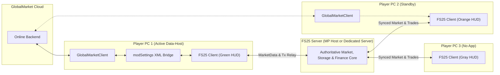

# FS25_GlobalMarket


**Dynamic Global & Simulated Commodity Trading for Farming Simulator 25 — built for Singleplayer, Multiplayer, and Dedicated Servers.**  
**Dynamischer Globaler & Simulierter Warenhandel für den Landwirtschafts-Simulator 25 — entwickelt für Singleplayer, Multiplayer und Dedicated Server.**

Developed by **D-S-Agrarservice [Floowy]** | Original Concept & Inspiration by **kevink98**

> **Language / Sprache:** **[🇬🇧 English Documentation](#english-documentation)** | **[🇩🇪 Deutsche Dokumentation](#deutsche-dokumentation)**

---

## English Documentation

### Table of Contents
- [Overview](#overview)
- [Key Features](#key-features)
- [Architecture & Multiplayer Topology](#architecture--multiplayer-topology)
- [HUD Status Indicator](#hud-status-indicator)
- [Installation & Controls](#installation--controls)
- [Modder & Mapper API](#modder--mapper-api)
- [Project Structure](#project-structure)
- [Credits & Origins](#credits--origins)
- [Contributing & Support](#contributing--support)
- [Copyright & License](#copyright--license)

---

### Overview

**FS25_GlobalMarket** adds a full-featured commodity exchange directly into the Farming Simulator 25 `ESC` menu. It automatically detects standard GIANTS silos, production storages, and pallet/bale warehouses on your farm, allowing you to buy and sell bulk crops, liquids, pallets, BigBags, IBC tanks, and bales from one central trading terminal.

GlobalMarket operates seamlessly in two modes:

1. **Simulated Offline Market (Out of the Box):** Works completely standalone without any external software. An internal market simulation dynamically adjusts stock levels, saturation prices, and Great Demand events based on your map's economy.
2. **Live Global Online Market (Optional Companion App):** By running the optional **[GlobalMarketClient](https://github.com/D-S-Agrarservice/GlobalMarketClient)** alongside the game, your session connects to a shared worldwide market where real player trades drive global supply, price trends, and Great Demand events across servers.

---

### Key Features

#### Economy & Fair Cross-Map Pricing
* **Anti-Arbitrage "Map Spy" Pricing:** The online backend never enforces flat euro prices. Instead, the server evaluates the genuine local base price across your map's selling stations (respecting economic difficulty and seasonal factors) and multiplies it by the global market trend (`Local Normal Price × Trend`).
* **Dynamic Supply & Demand:** High market stock lowers prices (down to `-30%`), while scarce stock drives prices up (up to `+30%` and beyond during Great Demands).
* **Great Demand Events:** Configurable scarcity-based or random Great Demands in Offline Mode, and authoritative worldwide Great Demand campaigns in Online Mode — announced directly via native FS25 HUD notifications.
* **Hybrid Moderation Mode (Custom Map/Mod Goods):** Dynamically discovers all `FillTypes` registered by your map and active mods. Officially approved goods trade live on the global online network, while newly discovered (`Pending | Offline`) or local-only (`Offline Only`) custom goods continue running seamlessly in the local offline simulation without interrupting gameplay.

#### Storage, Packaging & Logistics
* **Automatic Storage Detection:** Supports standard GIANTS Bulk Silos (`spec_silo`), Production Storages, and Object Storages (`spec_objectStorage`) for pallets and bales.
* **Deep Packaging Resolution:** Buy and sell loose liters or physical containers (Pallets, BigBags, BigBag Pallets, IBC Tanks, Round Bales, and Square Bales). Actively fermenting silage bales are safely excluded from trading until fermentation completes.
* **GM Logistics Terminals (`isGmMarket`):** Optional dedicated logistics buildings with strict multi-farm stock isolation on multiplayer servers, `0 €` delivery fees (physical self-delivery/pickup), configurable monthly storage fees, and optional storage expiration/decay warnings.

#### Native FS25 UI, Finances & Administration
* **Native `InGameMenu` Integration:** Cleanly injected tab in the FS25 `ESC` menu with live search filtering, 3 switchable category layouts (*Detailed*, *Compact*, *Flat A–Z*), trend arrows, and transparent cost breakdowns (base value, dealer markup, and delivery fees).
* **Dedicated Server Ready (Zero Server-Side `.exe` Required):** Uses a dynamic **Data-Host Token & Standby Failover** system so Dedicated Servers can participate in the live Online Market as soon as at least one connected player runs the Companion Client on their PC.
* **Environment-Aware Admin Settings:** Automatically maintains separate configuration profiles for Singleplayer (`sp`), Hosted Multiplayer (`mp`), and Dedicated Servers (`dedi`), configurable live from the FS25 Game Settings tab.
* **Finance Ledger Integration:** Registers dedicated `MoneyType` categories (simple or detailed view) in the native FS25 Finances screen.

---

### Architecture & Multiplayer Topology

Because the GIANTS Engine Lua sandbox restricts direct external network sockets, online communication uses an asynchronous, atomic XML bridge inside `modSettings/FS25_GlobalMarket/` combined with authoritative FS25 multiplayer events:



* **Automatic Token Failover:** If the active Data-Host disconnects or closes their Companion App, the server seamlessly reassigns the Data-Host Token to the next connected Standby client — or falls back cleanly to the simulated Offline Market without losing farm or storage data.
* **Server-Wide Rate Limiting:** Online transactions are authoritatively validated on the FS25 server with a global `15s` online sync cooldown to keep worldwide stock deltas consistent.

---

### HUD Status Indicator

When enabled in the settings, a compact status icon next to the top-right HUD info bar indicates your current connection state:

| Icon Color | Meaning |
| :--- | :--- |
| **Green** | Companion Client is running, connected to the backend, and your client is the active **Data-Host**. |
| **Orange** | Companion Client is running and connected, standing by for **automatic failover** while another player holds the Data-Host Token. |
| **Red** | Companion Client is running locally, but currently has **no connection** to the online backend. |
| **Gray** | **Offline Mode** (no local Companion Client active, or standard MP client trading via another player's Data-Host). |
| *Pulsing* | Brief 2-second pulse whenever a fresh online market data packet is synchronized. |

---

### Installation & Controls

#### Installation
1. Download the latest `FS25_GlobalMarket.zip` from the official release channel (GIANTS ModHub / GitHub Releases) and place it into your Farming Simulator 25 `mods` folder.
2. *(Optional – Online Mode)* Download and launch the **[GlobalMarketClient](https://github.com/D-S-Agrarservice/GlobalMarketClient)** (available via GitHub / **D-S-Agrarservice Discord**). Once running, GlobalMarket automatically detects the heartbeat and switches your session to the live Online Market.

#### Default Controls

| Action | Keyboard / Mouse | Gamepad |
| :--- | :--- | :--- |
| **Open / Close GlobalMarket Menu** | `Left Alt + M` *(or via `ESC` Menu Tab)* | `ESC` Menu Paging |
| **Switch Category View** *(Detailed / Compact / A–Z)* | `C` | `X` *(Menu Extra 1)* |

*(All keybindings can be customized in the standard FS25 Controls menu.)*

---

### Modder & Mapper API

GlobalMarket automatically discovers custom `FillTypes`, pallets, BigBags, and bales out of the box. For map authors, modders, and server admins who need fine-grained control over hidden `FillTypes`, liquid classifications, UI categories, or allowed container formats, GlobalMarket provides a zero-script XML API.

**3-Tier Loading Priority:**
1. **Basegame Defaults** (`GlobalMarketAPI.lua`)
2. **External Active Mods** (`gm_customs.xml` placed in the root directory of any active map or mod)
3. **Player / Server Fallback** (`modSettings/FS25_GlobalMarket/gm_fallback.xml` — fills gaps without overriding modder rules)

<details>
<summary><strong>Click to expand: <code>gm_customs.xml</code> / <code>gm_fallback.xml</code> Schema & Example</strong></summary>

Create a `gm_customs.xml` file in the root folder of your mod/map (next to your `modDesc.xml`):

```xml
<?xml version="1.0" encoding="utf-8" standalone="no"?>
<globalMarket>
    <!-- 1. Register custom FillTypeCategories that should be treated and billed as Liquids -->
    <finance>
        <liquidCategories>
            <category name="CUSTOM_LIQUID_CATEGORY" />
        </liquidCategories>
    </finance>

    <marketRegistration>
        <!-- 2. Whitelist: Force FillTypes onto the market even if showOnPriceTable="false" -->
        <!-- Optional attributes:
             category:        GRAINS | ROOTS | FORAGE | SUPPLIES | ANIMAL | PALLETS | OTHER
             compactCategory: CROPS_BULK | BALES_FORAGE | LIQUIDS | PALLETS_PRODUCTS -->
        <whitelist>
            <fillType name="LUPROSIL" category="SUPPLIES" compactCategory="LIQUIDS" />
            <fillType name="CUSTOM_SILAGE_ADDITIVE" category="SUPPLIES" compactCategory="PALLETS_PRODUCTS" />
        </whitelist>

        <!-- 3. UI Category Overrides: Recategorize FillTypes that already appear on the market -->
        <uiCategories>
            <fillType name="SPELT" category="GRAINS" compactCategory="CROPS_BULK" />
        </uiCategories>

        <!-- 4. Blacklist: Strictly exclude internal/technical FillTypes from GlobalMarket -->
        <blacklist>
            <fillType name="INTERNAL_DUMMY_FILLTYPE" />
        </blacklist>

        <!-- 5. Container Restrictions: Restrict specific FillTypes to allowed packaging unitKeys -->
        <!-- Supported unitKeys: ui_gm_unit_pallet, ui_gm_unit_bigbag, ui_gm_unit_bigbagpallet, ui_gm_unit_ibc -->
        <containerRestrictions>
            <restriction fillType="LUPROSIL">
                <allow unitKey="ui_gm_unit_ibc" />
                <allow unitKey="ui_gm_unit_pallet" />
            </restriction>
        </containerRestrictions>
    </marketRegistration>
</globalMarket>
```

</details>

<details>
<summary><strong>Click to expand: Creating Dedicated GM Logistics Buildings (<code>isGmMarket="true"</code>)</strong></summary>

Placeable modders can turn custom silos or object storages into official **GlobalMarket Terminals** (enabling `0 €` delivery costs, multi-farm isolated storage arrays on multiplayer servers, and GM storage fee/decay mechanics) simply by adding `isGmMarket="true"` in the placeable XML — no custom Lua specialization required:

```xml
<!-- For Bulk / Liquid Silos -->
<placeable ...>
    <silo isGmMarket="true" playerActionTrigger="..." ...>
        ...
    </silo>
</placeable>

<!-- For Pallet / Bale Object Storages -->
<placeable ...>
    <objectStorage isGmMarket="true" supportsBales="true" supportsPallets="true" ...>
        ...
    </objectStorage>
</placeable>
```

</details>

---

### Project Structure

```text
FS25_GlobalMarket/
├── GlobalMarket.lua          # Lean lifecycle orchestrator, InGameMenu injection & input bindings
├── modDesc.xml               # FS25 mod descriptor (descVersion 116)
├── events/                   # 11 dedicated Multiplayer synchronization & transaction events
├── gui/                      # GlobalMarketUI & GlobalMarketDialog controllers, XML layouts & profiles
├── images/                   # Menu & UI texture assets (.dds)
├── modules/                  # Specialized domain modules:
│   ├── GlobalMarketAPI.lua                   # 3-Tier whitelist/blacklist/category & metadata API
│   ├── GlobalMarketAccess.lua                # Multi-farm access & isolation hooks for GM Terminals
│   ├── GlobalMarketCompatibilityManager.lua  # Dynamic mod conflict firewall & mitigation rules
│   ├── GlobalMarketDebug.lua                 # Leveled logger with round-robin dump rotation
│   ├── GlobalMarketFinance.lua               # Unconditional MoneyType registration & ledger routing
│   ├── GlobalMarketOffline.lua               # Map-Spy pricing, local NPC simulation & Great Demands
│   ├── GlobalMarketOnline.lua                # Online trend pricing & authoritative Great Demand sync
│   ├── GlobalMarketSavegame.lua              # Savegame persistence for market stock & GM Terminals
│   ├── GlobalMarketSettings.lua              # Environment-aware (sp/mp/dedi) settings injection
│   ├── GlobalMarketStorage.lua               # Silo/ObjectStorage transfers, storage fees & decay
│   ├── GlobalMarketStoreCache.lua            # 2-phase deep XML scanner for pallets, BigBags & IBCs
│   └── GlobalMarketSync.lua                  # Companion App XML bridge, token failover & HUD icon
├── translations/             # Localized strings (DE, EN, ES, FR, PL)
└── xml/                      # In-game help configuration (helpLine_globalMarket.xml)
```

---

### Credits & Origins

* **Historic FS15 Pioneers — `Susi` & `Wingi`:** To give full and historically accurate credit where it is due: the very first origins of the Global Market idea go all the way back to **Susi** and **Wingi** in **Farming Simulator 15**. Even though things were naturally still a bit rough around the edges in those early days, they were the very first to get a Global Market up and running.
* **Special Thanks & FS17/FS19 Milestone — `kevink98`:** Recognizing the FS15 roots in no way diminishes the outstanding work of **kevink98**, who brought **GlobalMarket** (along with the **GlobalMarket Client** and his legendary **GlobalCompany** integration) to life in **FS17 and FS19** with a phenomenal implementation. Without his pioneering architecture, dedication, and inspiration, this project would never have been possible.
* **Ground-Up Redevelopment & AI Transparency:** While **FS25_GlobalMarket** builds conceptually upon that proud modding heritage (`Susi` & `Wingi` in FS15, and `kevink98` in FS17/FS19), the codebase is an almost complete ground-up redevelopment tailored specifically to **Farming Simulator 25 (GIANTS Engine 10)** — and was built with extensive assistance from modern AI development tools (Antigravity / AI). Full transparency: this project exists out of passion for the game and community, not to claim solo scripting wizardry, but to bring a clean, modern, multiplayer-ready GlobalMarket back into FS25.

---

### Contributing & Support

* **Bug Reports & Feature Requests:** Please open an Issue in this GitHub repository and attach your FS25 `log.txt` (plus steps to reproduce in Singleplayer vs. Multiplayer/Dedicated Server; not required for pure Feature Requests).
* **Pull Requests:** Clean, focused Pull Requests are welcome! Please keep individual Lua modules modular, maintain English code comments, and ensure full Multiplayer stream symmetry.
* **Community & Companion App:** Check out the **[GlobalMarketClient Repository](https://github.com/D-S-Agrarservice/GlobalMarketClient)** and join the **D-S-Agrarservice Discord** for news, online market events, and support.

---

### Copyright & License

**Copyright © D-S-Agrarservice [Floowy]. All Rights Reserved.**

* **No Unauthorized Re-Uploads:** Uploading this mod (in whole or in part) to third-party mod hosting websites, file-sharing paywalls, or unauthorized mirrors is **strictly prohibited**. Please always link to the official release channels (GIANTS ModHub / official GitHub Releases).
* **No Redistribution of Modified Versions:** Creating and publicly distributing modified, rebranded, or repackaged versions of `FS25_GlobalMarket` without prior written permission from the author is not permitted.
* **Modder Compatibility:** Using the documented `gm_customs.xml` interface or `isGmMarket="true"` XML attribute inside your own maps and placeable mods is explicitly encouraged and requires no special permission!

---
---

## Deutsche Dokumentation

### Inhaltsverzeichnis
- [Überblick](#überblick)
- [Hauptfunktionen](#hauptfunktionen)
- [Architektur & Multiplayer-Topologie](#architektur--multiplayer-topologie)
- [HUD-Statusanzeige](#hud-statusanzeige)
- [Installation & Steuerung](#installation--steuerung)
- [Modder & Mapper API (DE)](#modder--mapper-api-de)
- [Credits & Entstehung](#credits--entstehung)
- [Mitwirken & Support](#mitwirken--support)
- [Urheberrecht & Lizenz](#urheberrecht--lizenz)

---

### Überblick

**FS25_GlobalMarket** integriert eine vollwertige Warenbörse direkt in das `ESC`-Menü des Landwirtschafts-Simulators 25. Der Mod erkennt automatisch alle auf GIANTS-Standardskripten basierenden Hofsilos, Produktionslager sowie Paletten- und Ballenlager und ermöglicht den zentralen An- und Verkauf von Schüttgut, Flüssigkeiten, Paletten, BigBags, IBC-Tanks und Ballen.

Der Globale Markt arbeitet nahtlos in zwei Betriebsmodi:

1. **Simulierter Offline-Markt (Sofort spielbereit):** Funktioniert komplett eigenständig ohne externe Zusatzprogramme. Eine interne Marktsimulation berechnet dynamisch Bestände, Sättigungspreise und Große Nachfragen passend zur Wirtschaft deiner Karte.
2. **Globaler Live-Online-Markt (Optionaler Companion-Client):** Läuft parallel zum Spiel der optionale **[GlobalMarketClient](https://github.com/D-S-Agrarservice/GlobalMarketClient)**, verbindet sich deine Sitzung mit dem gemeinsamen Online-Markt, auf dem echte Käufe und Verkäufe anderer Spieler weltweit Angebot, Preistrends und Große Nachfragen beeinflussen.

---

### Hauptfunktionen

#### Wirtschaft & faires kartenübergreifendes Preissystem
* **Anti-Arbitrage „Map-Spy“-Preisberechnung:** Das Online-Backend gibt keine starren Euro-Festpreise vor. Stattdessen ermittelt der Server den realen lokalen Durchschnittspreis der Verkaufsstellen auf deiner Karte (inklusive Wirtschaftsschwierigkeitsgrad und saisonaler Schwankungen) und verrechnet ihn mit dem globalen Markttrend (`Lokaler Normalpreis × Trend`).
* **Dynamisches Angebot & Nachfrage:** Hohe Marktbestände senken den Preis (bis `-30 %`), knappe Bestände treiben ihn nach oben (bis `+30 %` und darüber hinaus bei Großen Nachfragen).
* **Große Nachfragen (Great Demands):** Einstellbare knappheitsbasierte oder zufällige Große Nachfragen im Offline-Modus sowie zentrale weltweite Kampagnen im Online-Modus – direkt angekündigt über native LS25-HUD-Meldungen.
* **Hybrider Moderations-Modus (Mod- & Map-Güter):** Erkennt automatisch alle zusätzlichen `FillTypes` deiner Karte und aktiven Mods. Offiziell freigegebene Güter laufen live über das globale Online-Netzwerk, während neue (`Ausstehend | Offline`) oder rein lokale (`Nur Offline`) Sondergüter unterbrechungsfrei über die lokale Offline-Simulation weitergehandelt werden können.

#### Lager, Gebinde & Logistik
* **Automatische Lagererkennung:** Unterstützt Standard-Schüttgutsilos (`spec_silo`), Produktionslager sowie Objektlager (`spec_objectStorage`) für Paletten und Ballen.
* **Tiefgehende Gebinde-Auswahl:** Kaufe und verkaufe lose Liter oder physische Gebinde (Paletten, BigBags, BigBag-Paletten, IBC-Tanks, Rundballen und Quaderballen). Noch gärende Silageballen sind während der Fermentation automatisch vom Handel ausgeschlossen.
* **GM-Logistik-Terminals (`isGmMarket`):** Optionale Spezialgebäude mit strikter Hof-Trennung im Multiplayer, `0 €` Lieferkosten (für physische Selbstanlieferung/-abholung), einstellbaren monatlichen Lagergebühren sowie optionaler Lagerräumung nach Ablauf der Lagerfrist.

#### Natives LS25-UI, Finanzen & Administration
* **Saubere `InGameMenu`-Integration:** Eigener Reiter im `ESC`-Menü mit Live-Suchfeld, 3 umschaltbaren Kategorie-Ansichten (*Detailliert*, *Kompakt*, *A–Z*), Preistrend-Pfeilen und transparenter Kostenaufschlüsselung (Warenwert, Händleraufschlag, Lieferkosten).
* **Dedicated-Server-tauglich (Keine `.exe` auf dem Server nötig):** Über ein dynamisches **Data-Host-Token- & Standby-Failover-System** kann auch ein Dedicated Server live am Online-Markt teilnehmen, sobald mindestens ein verbundener Spieler auf seinem PC den `GlobalMarketClient` gestartet hat.
* **Profilgetrennte Admin-Einstellungen:** Verwaltet automatisch getrennte Einstellungsprofile für Singleplayer (`sp`), gehosteten Multiplayer (`mp`) und Dedicated Server (`dedi`) direkt in den LS25-Spieleinstellungen.
* **Finanzübersicht:** Eigene `MoneyType`-Buchungskategorien (kompakt oder detailliert umschaltbar) direkt im LS25-Finanzmenü.

---

### Architektur & Multiplayer-Topologie

Da die Lua-Sandbox der GIANTS Engine keine direkten externen Netzwerk-Sockets zulässt, läuft der Online-Datenaustausch über eine asynchrone, atomare XML-Brücke unter `modSettings/FS25_GlobalMarket/` in Kombination mit autoritativen LS25-Multiplayer-Events *(siehe [Mermaid-Architekturdiagramm oben](#architecture--multiplayer-topology))*:

* **Automatischer Token-Failover:** Verlässt der aktive Data-Host den Server oder schließt den Client, übergibt der Server das Data-Host-Token nahtlos an den nächsten verbundenen Standby-Spieler – oder schaltet verlustfrei auf den simulierten Offline-Markt zurück.
* **Serverseitiges Rate-Limiting:** Online-Transaktionen werden autoritativ vom LS25-Server geprüft und mit einem globalen `15s`-Sync-Cooldown getaktet, damit weltweite Bestandsänderungen konsistent bleiben.

---

### HUD-Statusanzeige

Ist die Statusanzeige in den Einstellungen aktiviert, zeigt ein kompaktes Icon oben rechts neben der HUD-Infoleiste den aktuellen Verbindungsstatus:

| Icon-Farbe | Bedeutung |
| :--- | :--- |
| **Grün** | `GlobalMarketClient` läuft lokal, ist mit dem Backend verbunden und dein Spielclient ist der aktive **Data-Host**. |
| **Orange** | `GlobalMarketClient` läuft und ist verbunden, steht im **Standby für automatisches Failover** bereit, während ein anderer Spieler Data-Host ist. |
| **Rot** | `GlobalMarketClient` läuft lokal, hat aber aktuell **keine Verbindung** zum Online-Backend. |
| **Grau** | **Offline-Modus** (kein lokaler Client aktiv, oder regulärer MP-Client, der über den Data-Host eines Mitspielers handelt). |
| *Pulsierend* | Kurzes 2-Sekunden-Pulsieren bei jedem frisch synchronisierten Online-Marktdatenpaket. |

---

### Installation & Steuerung

#### Installation
1. Lade die aktuelle `FS25_GlobalMarket.zip` über die offiziellen Kanäle (GIANTS ModHub / GitHub Releases) herunter und lege sie in deinen LS25-`mods`-Ordner.
2. *(Optional – Online-Modus)* Lade den **[GlobalMarketClient](https://github.com/D-S-Agrarservice/GlobalMarketClient)** herunter und starte ihn parallel zum Spiel. Der Mod erkennt das Lebenszeichen automatisch und schaltet deine Sitzung auf den Live-Online-Markt um.

#### Standard-Tastenbelegung

| Aktion | Tastatur / Maus | Gamepad |
| :--- | :--- | :--- |
| **GlobalMarket-Menü öffnen / schließen** | `Links Alt + M` *(oder über den `ESC`-Menüreiter)* | `ESC`-Menü durchblättern |
| **Kategorie-Ansicht wechseln** *(Detailliert / Kompakt / A–Z)* | `C` | `X` *(Menü Extra 1)* |

*(Alle Tastenbelegungen lassen sich jederzeit in den normalen LS25-Steuerungsoptionen anpassen.)*

---

### Modder & Mapper API (DE)

GlobalMarket erkennt benutzerdefinierte `FillTypes`, Paletten, BigBags und Ballen standardmäßig vollautomatisch. Kartenbauer, Modder und Server-Admins, die versteckte `FillTypes` gezielt freischalten, Flüssigkeitskategorien ergänzen, UI-Kategorien anpassen oder erlaubte Gebinde einschränken möchten, können dies komplett skriptfrei per XML steuern.

**3-stufige Ladepriorität:**
1. **Basegame-Standards** (`GlobalMarketAPI.lua`)
2. **Aktive Fremd-Mods & Maps** (`gm_customs.xml` im Hauptverzeichnis der jeweiligen Map bzw. des Mods)
3. **Spieler- / Server-Fallback** (`modSettings/FS25_GlobalMarket/gm_fallback.xml` – ergänzt fehlende Einträge, ohne Vorgaben von Moddern zu überschreiben)

*(Vollständige XML-Beispiele für `gm_customs.xml` sowie `isGmMarket="true"` für eigene GM-Logistikgebäude findest du direkt in den aufklappbaren Beispielblöcken unter [Modder & Mapper API](#modder--mapper-api).)*

---

### Credits & Entstehung

* **Die allerersten Wurzeln im LS15 — `Susi` & `Wingi`:** Um historisch vollständig und fair zu bleiben: Die ganz ursprüngliche Geschichte des Globalen Marktes geht zurück auf **Susi** und **Wingi** im **Landwirtschafts-Simulator 15**. Auch wenn es damals technisch naturgemäß noch etwas holprig war – sie hatten das Konzept als Allererstes überhaupt am Laufen und haben damit den Ur-Grundstein gelegt.
* **Besonderer Dank & Meilenstein im LS17/LS19 — `kevink98`:** Der Blick auf die LS15-Wurzeln schmälert in keiner Weise die großartige Arbeit von **kevink98**, der den **GlobalMarket** (samt damaligem **GlobalMarket-Client** und der legendären **GlobalCompany**-Einbindung) im **LS17 und LS19** auf ein völlig neues Niveau gehoben und über Jahre geprägt hat. Ohne seine herausragende Umsetzung, seine Ideen und dieses Vorbild wäre dieses Projekt schlicht nicht möglich gewesen!
* **Neuentwicklung für den LS25 & offener Umgang mit KI (AI):** **FS25_GlobalMarket** knüpft konzeptionell an diese Geschichte an (`Susi` & `Wingi` im LS15 sowie `kevink98` im LS17/LS19), ist unter der Haube jedoch eine nahezu vollständige Neuentwicklung speziell für den **Landwirtschafts-Simulator 25 (GIANTS Engine 10)** – und ist maßgeblich mithilfe moderner KI-Entwicklungswerkzeuge (Antigravity / AI) entstanden. Ganz offen und ehrlich: Hier will sich niemand als unfehlbarer „Überscripter“ darstellen – das Ziel war es, mit Herzblut, sauberer Architekturprüfung und KI-Unterstützung den GlobalMarket zeitgemäß, performant und voll multiplayerfähig in den LS25 zurückzubringen.

---

### Mitwirken & Support

* **Fehlermeldungen & Feature-Wünsche:** Erstelle gerne ein Issue hier im GitHub-Repository und hänge bei Fehlern bitte immer deine vollständige LS25-`log.txt` sowie kurze Schritte zum Nachstellen (Singleplayer vs. Multiplayer / Dedi) an.
* **Pull Requests:** Saubere, fokussierte Pull Requests sind herzlich willkommen! Bitte halte einzelne Lua-Module übersichtlich, belasse Code-Kommentare auf Englisch und achte auf strikte Stream-Symmetrie bei Multiplayer-Events.
* **Community & Online-Client:** Schau im **[GlobalMarketClient-Repository](https://github.com/D-S-Agrarservice/GlobalMarketClient)** sowie auf dem **D-S-Agrarservice Discord** vorbei für Updates, Online-Markt-Infos und Support.

---

### Urheberrecht & Lizenz

**Copyright © D-S-Agrarservice [Floowy]. Alle Rechte vorbehalten (All Rights Reserved).**

* **Keine unerlaubten Re-Uploads:** Das erneute Hochladen dieses Mods (ganz oder in Teilen) auf fremden Mod-Plattformen, hinter Paywall-/Filehoster-Links oder auf nicht autorisierten Seiten ist **ausdrücklich untersagt**. Bitte verlinkt immer auf die offiziellen Download-Quellen (GIANTS ModHub / offizielle GitHub Releases).
* **Keine Weitergabe veränderter Versionen:** Das Veröffentlichen oder Weiterverbreiten umgebauter, umbenannter oder neu gepackter Versionen von `FS25_GlobalMarket` ohne vorherige schriftliche Zustimmung des Autors ist nicht gestattet.
* **Modder- & Mapper-Freigabe:** Die Nutzung der dokumentierten `gm_customs.xml`-Schnittstelle sowie des XML-Attributs `isGmMarket="true"` in eigenen Karten und Gebäude-Mods ist ausdrücklich erwünscht und bedarf keiner gesonderten Anfrage!
