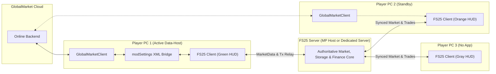

<div align="center">

# FS25_GlobalMarket

**Commodity Market, Supply Contracts, Used Vehicle & Animal Market for Farming Simulator 25 — built for Singleplayer, Multiplayer and Dedicated Servers.**


🌐 **English** · [**🇩🇪 Deutsch**](./README.de.md)

[**🔌 GlobalMarketClient**](https://github.com/D-S-Agrarservice/GlobalMarketClient) · [**📄 Interface Spec**](https://github.com/D-S-Agrarservice/GlobalMarketClient/blob/main/docs/External_Interface_Specification_FS25_GlobalMarket_Mod2EXE.md)

Developed by **D-S-Agrarservice [Floowy]** | Original concept & inspiration by **kevink98**

</div>

---

### Table of Contents
- [Overview](#overview)
- [Key Features](#key-features)
- [Architecture & Multiplayer Topology](#architecture--multiplayer-topology)
- [HUD Status Indicator](#hud-status-indicator)
- [Installation & Controls](#installation--controls)
- [Modder & Mapper API](#modder--mapper-api)
- [Project Structure](#project-structure)
- [Credits, Origins & AI Transparency](#credits-origins--ai-transparency)
- [Contributing & Support](#contributing--support)
- [Copyright & License](#copyright--license)

---

### Overview

**FS25_GlobalMarket** adds its own tab to the Farming Simulator 25 `ESC` menu that bundles four trading areas:

1. **Commodity Market:** Buy and sell bulk crops, liquids, pallets, BigBags, IBC tanks and bales straight from your silos, production storages and object storages — with dynamic stock levels, saturation prices and Great Demand events.
2. **Supply Contracts & Direct Offers:** Players and NPC contractors post delivery contracts with a price bonus; farms and NPC traders sell lots at up to `±10 %` of the market price.
3. **Used Vehicle Market:** List your own vehicles and implements at your own asking price, and buy used vehicles from other farms and NPC dealers right in the basegame shop screen.
4. **Animal Market:** Sell and buy livestock between farms and NPC animal dealers with their full state — age, health and pregnancy — delivered to your barn or picked up with your own livestock trailer at the animal dealer; at a fixed price or as an auction.

Everything works **out of the box** with a simulated offline market — no external software required. With the optional companion app **[GlobalMarketClient](https://github.com/D-S-Agrarservice/GlobalMarketClient)** running alongside the game, your session joins a shared worldwide market where real player trades drive global supply, price trends and Great Demand events across servers.

---

### Key Features

#### Commodity Market & Fair Cross-Map Pricing
* **Anti-Arbitrage "Map Spy" Pricing:** The online backend never enforces flat euro prices. Instead, the mod evaluates the genuine local base price across your map's selling stations (respecting economic difficulty and seasonal factors) and multiplies it by the market trend (`Local Normal Price × Trend`).
* **Dynamic Supply & Demand:** High market stock lowers prices (down to `-30 %`), while scarce stock drives prices up (up to `+30 %` and beyond during Great Demands).
* **Great Demand Events:** Configurable scarcity-based or random Great Demands in offline mode, and authoritative worldwide Great Demand campaigns in online mode — announced directly via native FS25 HUD notifications.
* **Hybrid Moderation Mode (Custom Map/Mod Goods):** Dynamically discovers all `FillTypes` registered by your map and active mods. Officially approved goods trade live on the global online market, while newly discovered (`Pending | Offline`) or local-only (`Offline Only`) custom goods keep running seamlessly in the local offline simulation.

#### Storage, Packaging & Logistics
* **Automatic Storage Detection:** Supports standard GIANTS bulk silos (`spec_silo`), production storages and object storages (`spec_objectStorage`) for pallets and bales.
* **Deep Packaging Resolution:** Buy and sell loose liters or physical containers (pallets, BigBags, BigBag pallets, IBC tanks, round bales and square bales). Silage bales that are still fermenting are safely excluded until fermentation completes.
* **GM Logistics Terminals (`isGmMarket`):** Optional dedicated logistics buildings with strict multi-farm stock isolation on multiplayer servers, `0 €` delivery fees (physical self-delivery/pickup), configurable monthly storage fees and optional clearance after the storage period.
* **Remaining Storage Time:** A countdown icon in the storage list marks goods held in a GM Terminal (green = normal, orange = increased fees, red = clearance imminent). The exact remaining time is shown for the selected product and in the sell dialog.

#### Supply Contracts & Direct Offers
* **Supply Contracts:** Players and NPC contractors post delivery contracts (1–6 months) with a price bonus on top of the market price. Player contracts are backed by an escrow the issuer deposits up front; if an accepted contract is not fulfilled by its deadline, the supplier pays a `15 %` penalty on the undelivered value.
* **Direct Offers:** Sell lots to other farms or NPC traders at up to `±10 %` of the current market price.
* **NPC Board Follows the Market:** NPC contractors mainly ask for goods that are scarce and pay a higher bonus for them; NPC traders mainly offer goods in surplus at a deeper discount. With the online market active, this follows the global stock.
* **Map Stations as Delivery Targets:** Local NPC contracts can name a real selling station or unowned production on the map. Unloading there counts towards the contract, and the station can be tagged on the map (incl. navigation) straight from the contract list, just like in the basegame prices menu.
* **Pickup Inbox:** Goods that cannot be placed into a matching storage right away are kept in a per-farm inbox for a grace period before being sold off automatically.
* **Cross-Server Online Contracts:** Contracts and offers can also be published to and accepted from other servers via the GlobalMarketClient as soon as the online backend supports it. Admins choose which parts go online (all, contracts only, offers only, or local only).

#### Used Vehicle Market
* **Sell at Your Own Price:** List any owned vehicle or implement — from front weights to flagship tractors, mod vehicles included — at 70–130 % of its dealer value for 1–12 months. Configuration, custom paint, operating hours, damage and wear travel with it.
* **View & Buy in the Native Shop:** Listings of other farms open in the basegame shop screen with their exact configuration and paint. Switching options is preview only — vehicles are always sold as listed. Mod vehicles only show up where the identical mod file is installed.
* **NPC Dealers:** Dealers buy your listings (the cheaper, the faster, minus 5 % commission) and list used vehicles of their own (admin setting: Off / Low / Normal).
* **Notices & Finances:** HUD notices for new listings, sales and returns (can be turned off per player); purchases and sales are booked to the basegame vehicle finance categories.
* **Multiplayer:** Trading runs between all farms on your server. Cross-server listings via the GlobalMarketClient are planned.

#### Animal Market
* **Sell Exactly These Animals:** List a group from your own barn, or from your own livestock trailer standing at the animal dealer, at 80–200 % of its dealer value for 1–3 months (up to 10 listings per farm). Age, health and pregnancy travel with the animals (horses keep name and fitness); they do not age while listed.
* **Buy With Delivery or Pickup:** Barn delivery into an automatically chosen or a selected barn plus the basegame transport fee, or pickup without fee: the animals wait in your pickup box and are loaded onto your own livestock trailer at the animal dealer — from the GM menu or with the normal key right at the dealer.
* **Returns Without Losses:** Withdrawn or expired animals return to their original barn first, then to a barn with the same breed; if there is no space, they wait in the pickup box and are retried hourly.
* **Auctions:** Instead of a fixed price, animals can be auctioned: start price 50–150 % of the dealer value, duration 6, 12, 24 or 48 hours, optional buy-now price. Bids are reserved at once, an outbid bidder gets the money back immediately, own bids can be raised. A bid in the last hour extends the auction by one hour; an auction with bids can no longer be withdrawn. Own bids are listed under "My bids", a filter shows auctions only.
* **NPC Animal Dealers:** Dealers buy your listings (the cheaper, the faster, minus 5 % commission) and offer animals of their own — incl. pregnant animals and age stages the basegame dealer does not sell, some of them as auctions. NPC dealers also bid on auctions, each up to a hidden limit; pregnant and very healthy animals are worth more to them (admin setting: Off / Low / Normal).
* **Great Demand for Slaughter Animals:** About once a month, NPC dealers look for slaughter-ready meat animals of one animal type for 1–3 days (at least 50 % health) and pay 20–40 % above the dealer value. Matching groups are highlighted in the menu and sold directly.
* **Packs, DLCs & Compatibility:** Only breeds that exist on the server are shown. Mods that replace the animal system (e.g. RealisticLivestock) disable the animal market with a notice.

#### Native FS25 UI, Finances & Administration
* **Native `InGameMenu` Integration:** Cleanly injected tab in the FS25 `ESC` menu with sub-tabs for the market, contracts and the marketplace (used vehicles & animals), live search filtering, 3 switchable category layouts (*Detailed*, *Compact*, *Flat A–Z*), trend arrows, a map price comparison (map average, best selling point and the market's difference in the footer for the selected good) and transparent cost breakdowns (base value, dealer markup and delivery fees).
* **In-Game Help:** Dedicated GlobalMarket pages in the FS25 help menu explain every area.
* **Dedicated Server Ready (Nothing to Install on the Server):** A dynamic **Data-Host Token & Standby Failover** system lets Dedicated Servers join the live online market as soon as at least one connected player runs the GlobalMarketClient on their PC.
* **In-Game Market Switch:** If several market keys are saved in the GlobalMarketClient (e.g. private community markets), the active Data-Host switches between the official Global Market and these markets right from the market menu — in multiplayer only as admin and after a confirmation, with a 30-second cooldown. Header, prices and approved goods follow the new market automatically.
* **Environment-Aware Admin Settings:** Separate configuration profiles for Singleplayer (`sp`), hosted Multiplayer (`mp`) and Dedicated Servers (`dedi`), configurable live from the FS25 game settings: delivery fees, dealer markup, market capacity, storage fees & decay, Great Demand mode, NPC activity, online contracts, contract limits, NPC board size, NPC vehicle dealers and NPC animal dealers.
* **Basegame Farm Permissions:** Admins and farm managers may do everything, other farm members only what their role allows — "buy vehicles" / "sell vehicles" on the vehicle market, "trade animals" on the animal market, "manage contracts" for delivery contracts. The server checks every request, the menu answers first with a notice; while the menu is open, errors show as a dialog instead of the HUD.
* **Finance Ledger Integration:** Dedicated `MoneyType` categories (simple or detailed view) in the native FS25 finances screen.

---

### Architecture & Multiplayer Topology

Because the GIANTS Engine Lua sandbox blocks direct external network connections, online communication uses an asynchronous, atomic XML bridge inside `modSettings/FS25_GlobalMarket/` combined with authoritative FS25 multiplayer events:



* **Automatic Token Failover:** If the active Data-Host disconnects or closes the GlobalMarketClient, the server seamlessly reassigns the Data-Host Token to the next connected standby player — or falls back cleanly to the simulated offline market without losing farm or storage data.
* **Server-Wide Rate Limiting:** Online transactions are authoritatively validated on the FS25 server with a global `15 s` online sync cooldown to keep worldwide stock deltas consistent.
* **Server-Authoritative Trading:** Contracts, offers, vehicle and animal listings are processed on the FS25 server only and synced to all players via dedicated multiplayer events.

---

### HUD Status Indicator

When enabled in the settings, a compact status icon next to the top-right HUD info bar shows your current connection state:

| Icon Color | Meaning |
| :--- | :--- |
| **Green** | The GlobalMarketClient is running, connected to the backend, and your game is the active **Data-Host**. |
| **Orange** | The GlobalMarketClient is running and connected, standing by for **automatic failover** while another player holds the Data-Host Token. |
| **Red** | The GlobalMarketClient is running locally, but currently has **no connection** to the online backend. |
| **Gray** | **Offline mode** (no local GlobalMarketClient running, or a regular MP client trading via another player's Data-Host). |
| *Pulsing* | Brief 2-second pulse whenever a fresh online market data packet is synchronized. |

---

### Installation & Controls

#### Installation
1. Download the latest `FS25_GlobalMarket.zip` from the official release channel (GIANTS ModHub / GitHub Releases) and place it into your Farming Simulator 25 `mods` folder.
2. *(Optional – online mode)* Download and launch the **[GlobalMarketClient](https://github.com/D-S-Agrarservice/GlobalMarketClient)** (available via GitHub / **D-S-Agrarservice Discord**). Once it runs, GlobalMarket detects its heartbeat automatically and switches your session to the live online market.

#### Default Controls

| Action | Keyboard / Mouse | Gamepad |
| :--- | :--- | :--- |
| **Open / Close GlobalMarket Menu** | `Left Alt + M` *(or via the `ESC` menu tab)* | `ESC` menu paging |
| **Switch Category View** *(Detailed / Compact / A–Z)* | `C` | `X` *(Menu Extra 1)* |
| **Contracts, Vehicle & Animal Market Actions** *(accept, cancel, list, buy, bid, load onto trailer, filter / sort, tag station on map, switch view)* | As shown in the menu footer | As shown in the menu footer |

*(All keybindings can be customized in the standard FS25 controls menu.)*

---

### Modder & Mapper API

GlobalMarket automatically discovers custom `FillTypes`, pallets, BigBags and bales out of the box. For map authors, modders and server admins who need fine-grained control over hidden `FillTypes`, liquid classifications, UI categories or allowed container formats, GlobalMarket provides a zero-script XML API.

**3-Tier Loading Priority:**
1. **Basegame Defaults** (`GlobalMarketAPI.lua`)
2. **External Active Mods** (`gm_customs.xml` placed in the root directory of any active map or mod)
3. **Player / Server Fallback** (`modSettings/FS25_GlobalMarket/gm_fallback.xml` — fills gaps without overriding modder rules)

<details>
<summary><strong>Click to expand: <code>gm_customs.xml</code> / <code>gm_fallback.xml</code> Schema & Example</strong></summary>

Create a `gm_customs.xml` file in the root folder of your mod/map (next to your `modDesc.xml`):

```xml
<?xml version="1.0" encoding="utf-8" standalone="no"?>
<globalMarket>
    <!-- 1. Register custom FillTypeCategories that should be treated and billed as Liquids -->
    <finance>
        <liquidCategories>
            <category name="CUSTOM_LIQUID_CATEGORY" />
        </liquidCategories>
    </finance>

    <marketRegistration>
        <!-- 2. Whitelist: Force FillTypes onto the market even if showOnPriceTable="false" -->
        <!-- Optional attributes:
             category:        GRAINS | ROOTS | FORAGE | SUPPLIES | ANIMAL | PALLETS | OTHER
             compactCategory: CROPS_BULK | BALES_FORAGE | LIQUIDS | PALLETS_PRODUCTS -->
        <whitelist>
            <fillType name="LUPROSIL" category="SUPPLIES" compactCategory="LIQUIDS" />
            <fillType name="CUSTOM_SILAGE_ADDITIVE" category="SUPPLIES" compactCategory="PALLETS_PRODUCTS" />
        </whitelist>

        <!-- 3. UI Category Overrides: Recategorize FillTypes that already appear on the market -->
        <uiCategories>
            <fillType name="SPELT" category="GRAINS" compactCategory="CROPS_BULK" />
        </uiCategories>

        <!-- 4. Blacklist: Strictly exclude internal/technical FillTypes from GlobalMarket -->
        <blacklist>
            <fillType name="INTERNAL_DUMMY_FILLTYPE" />
        </blacklist>

        <!-- 5. Container Restrictions: Restrict specific FillTypes to allowed packaging unitKeys -->
        <!-- Supported unitKeys: ui_gm_unit_pallet, ui_gm_unit_bigbag, ui_gm_unit_bigbagpallet, ui_gm_unit_ibc -->
        <containerRestrictions>
            <restriction fillType="LUPROSIL">
                <allow unitKey="ui_gm_unit_ibc" />
                <allow unitKey="ui_gm_unit_pallet" />
            </restriction>
        </containerRestrictions>
    </marketRegistration>
</globalMarket>
```

</details>

<details>
<summary><strong>Click to expand: Creating Dedicated GM Logistics Buildings (<code>isGmMarket="true"</code>)</strong></summary>

Placeable modders can turn custom silos or object storages into official **GlobalMarket Terminals** (enabling `0 €` delivery costs, multi-farm isolated storage on multiplayer servers, and GM storage fee/decay mechanics) simply by adding `isGmMarket="true"` in the placeable XML — no custom Lua specialization required:

```xml
<!-- For Bulk / Liquid Silos -->
<placeable ...>
    <silo isGmMarket="true" playerActionTrigger="..." ...>
        ...
    </silo>
</placeable>

<!-- For Pallet / Bale Object Storages -->
<placeable ...>
    <objectStorage isGmMarket="true" supportsBales="true" supportsPallets="true" ...>
        ...
    </objectStorage>
</placeable>
```

</details>

---

### Project Structure

```text
FS25_GlobalMarket/
├── GlobalMarket.lua          # Lean lifecycle orchestrator, InGameMenu injection & input bindings
├── modDesc.xml               # FS25 mod descriptor (descVersion 116)
├── events/                   # 19 dedicated multiplayer sync, transaction, contract, vehicle & animal market events
├── gui/                      # Market UI, Contracts & Marketplace sub-tabs, four dialogs (controllers, XML layouts & profiles)
│   ├── GlobalMarketUI.lua / .xml             # Main InGameMenu frame: storage & market lists, search, categories
│   ├── GlobalMarketCategories.lua            # Category view modes, fillType lookup tables & classification
│   ├── GlobalMarketContractsUI.lua           # Sub-tab controller: supply contracts, direct offers & Pickup Inbox
│   ├── GlobalMarketContractsUIActions.lua    # Contract sub-tab actions: filter, create, cancel, accept & marker
│   ├── GlobalMarketDialog.lua / .xml         # Buy/sell transaction dialog (storage, packaging format, fee preview)
│   ├── GlobalMarketContractDialog.lua / .xml # Multi-mode dialog for contracts, offers & inbox withdrawals
│   ├── GlobalMarketVehiclesUI.lua            # Sub-tab controller: own vehicles & listings, used vehicle market
│   ├── GlobalMarketVehicleDialog.lua / .xml  # Dialog to list a vehicle (asking price, duration)
│   ├── GlobalMarketVehicleShopBridge.lua     # View & buy listings in the basegame shop screen
│   ├── GlobalMarketAnimalsUI.lua             # Marketplace animal view: own groups, listings, bids & pickup box, animal market
│   ├── GlobalMarketAnimalDialog.lua / .xml   # Dialog to list (fixed price/auction), buy, bid & sell to the great demand
│   └── guiProfiles.xml                       # Shared GUI profiles
├── images/                   # Menu & UI texture assets (.dds)
├── modules/                  # Specialized domain modules:
│   ├── GlobalMarketAPI.lua                   # 3-tier whitelist/blacklist/category & metadata API
│   ├── GlobalMarketAccess.lua                # Multi-farm access & isolation hooks for GM Terminals
│   ├── GlobalMarketAnimalAuction.lua         # Animal auctions: bids, buy-now, settlement & delivery
│   ├── GlobalMarketAnimalAuctionNpc.lua      # NPC bidders with hidden limits for animal auctions
│   ├── GlobalMarketAnimalDemand.lua          # Great demand for slaughter-ready meat animals
│   ├── GlobalMarketAnimalListings.lua        # Animal snapshots (escrow), eligibility, dealer values & barn placement
│   ├── GlobalMarketAnimalMarket.lua          # Animal listing store, returns, pickup box & savegame
│   ├── GlobalMarketAnimalNpc.lua             # NPC animal dealers buying and listing animals
│   ├── GlobalMarketAnimalTrade.lua           # Animal purchases, trailer loading, dealer detection, sync & notices
│   ├── GlobalMarketAuction.lua               # Generic auction engine: escrow, minimum increment, extension, savegame
│   ├── GlobalMarketBranding.lua              # 3-tier online market branding (synced name & local logo)
│   ├── GlobalMarketCompatibilityManager.lua  # Dynamic mod conflict firewall & mitigation rules
│   ├── GlobalMarketContracts.lua             # Supply contracts, stock-driven NPC board, escrow & penalties
│   ├── GlobalMarketContractsOnline.lua       # Cross-server online contracts & offers (Pending -> Ack)
│   ├── GlobalMarketContractsOnlineSync.lua   # Incoming contractData parser, settlements & snapshot merge
│   ├── GlobalMarketContractsStations.lua     # Map selling stations as physical contract delivery targets
│   ├── GlobalMarketContractsStorage.lua      # Contract/offer storage withdrawals, deposits & Pickup Inbox
│   ├── GlobalMarketDebug.lua                 # Leveled logger with round-robin dump rotation
│   ├── GlobalMarketFarmCleanup.lua           # Cleanup of farm-keyed GM data on farm deletion
│   ├── GlobalMarketFinance.lua               # MoneyType registration, ledger routing, GM storage fees & decay
│   ├── GlobalMarketMapPriceHint.lua          # Spot market map price comparison: average, best selling point
│   ├── GlobalMarketMarketSwitch.lua          # In-game switch between the Global Market and the client's private market profiles
│   ├── GlobalMarketOffers.lua                # ±10 % direct offers, NPC buying & contracts savegame persistence
│   ├── GlobalMarketOffline.lua               # Map Spy pricing, local NPC simulation & Great Demands
│   ├── GlobalMarketOnline.lua                # Online trend pricing, client version floor & offline state restore
│   ├── GlobalMarketPermissions.lua           # Basegame farm permissions for the markets & in-menu errors
│   ├── GlobalMarketSavegame.lua              # Savegame persistence for market stock & GM Terminals
│   ├── GlobalMarketSettings.lua              # Environment-aware (sp/mp/dedi) settings injection
│   ├── GlobalMarketStorage.lua               # Silo/ObjectStorage discovery & market transfers
│   ├── GlobalMarketStorageAge.lua            # Remaining GM storage time: client sync & UI display
│   ├── GlobalMarketStoreCache.lua            # 2-phase deep XML scanner for pallets, BigBags & IBCs
│   ├── GlobalMarketSync.lua                  # GlobalMarketClient XML bridge, token failover & HUD icon
│   ├── GlobalMarketVehicleListings.lua       # Vehicle snapshots, listing groups, eligibility & dealer value
│   ├── GlobalMarketVehicleMarket.lua         # Vehicle listing store, returns to seller & savegame
│   ├── GlobalMarketVehicleNpc.lua            # NPC dealers buying and listing used vehicles
│   └── GlobalMarketVehicleTrade.lua          # Vehicle purchases, hourly expiry, sync & HUD notices
├── translations/             # Localized strings (DE, EN, ES, FR, PL)
└── xml/                      # In-game help configuration (helpLine_globalMarket.xml)
```

---

### Credits, Origins & AI Transparency

#### Project Team & Contributors
* **Project Lead, GlobalMarket Mod & GlobalMarketClient:** **Floowy** (*D-S-Agrarservice*)
* **Server Architecture & Online Backend (`FastAPI`):** **FGBxRamel** (*bydora.de*)
* **Core Team & Project Support:** **Kastor** *(Modding Team Lead)*, **Murphy**, **DSA-Testteam**
* **Concept Ideas & External Consulting:** **Tensuko** *(Concept Ideas)*, **Farmsim Tim** *(External Consulting)*
* **Testing, Suggestions & Community Feedback:** **Flamy**, **PascalE**, **WeekendFarmers-Testcrew**, **OMG_its_Breide**, **OnkelSander83**

#### Historic Roots & Pioneers
* **Historic FS15 Pioneers — `Susi` & `Wingi`:** To give full and historically accurate credit where it is due: the very first origins of the Global Market idea go all the way back to **Susi** and **Wingi** in **Farming Simulator 15**. Even though things were naturally still a bit rough around the edges in those early days, they were the very first to get a Global Market up and running.
* **Special Thanks & FS17/FS19 Milestone — `kevink98`:** Recognizing the FS15 roots in no way diminishes the outstanding work of **kevink98**, who brought **GlobalMarket** (along with its original companion client and his legendary **GlobalCompany** integration) to life in **FS17 and FS19** with a phenomenal implementation. Without his pioneering architecture, dedication and inspiration, this project would never have been possible.

#### Ground-Up Redevelopment & AI Transparency
While **FS25_GlobalMarket** builds conceptually upon that proud modding heritage (`Susi` & `Wingi` in FS15, and `kevink98` in FS17/FS19), the codebase is an almost complete ground-up redevelopment tailored specifically to **Farming Simulator 25 (GIANTS Engine 10)** — built with extensive assistance from modern AI development tools (**Antigravity** and **Claude Code**).
Full transparency: this project exists out of passion for the game and community, not to claim solo scripting wizardry, but to bring a clean, modern, multiplayer-ready GlobalMarket back into FS25.

---

### Contributing & Support

* **Bug Reports & Feature Requests:** Please open an Issue in this GitHub repository and attach your FS25 `log.txt` (plus steps to reproduce in Singleplayer vs. Multiplayer/Dedicated Server; not required for pure feature requests).
* **Pull Requests:** Clean, focused Pull Requests are welcome! Please keep individual Lua modules modular, keep code comments in English, and ensure full multiplayer stream symmetry.
* **Community & GlobalMarketClient:** Check out the **[GlobalMarketClient repository](https://github.com/D-S-Agrarservice/GlobalMarketClient)** and join the **D-S-Agrarservice Discord** for news, online market events and support.

---

### Copyright & License

**Copyright © D-S-Agrarservice [Floowy]. All Rights Reserved.**

* **No Unauthorized Re-Uploads:** Uploading this mod (in whole or in part) to third-party mod hosting websites, file-sharing paywalls or unauthorized mirrors is **strictly prohibited**. Please always link to the official release channels (GIANTS ModHub / official GitHub Releases).
* **No Redistribution of Modified Versions:** Creating and publicly distributing modified, rebranded or repackaged versions of `FS25_GlobalMarket` without prior written permission from the author is not permitted.
* **Modder Compatibility:** Using the documented `gm_customs.xml` interface or the `isGmMarket="true"` XML attribute inside your own maps and placeable mods is explicitly encouraged and requires no special permission!
