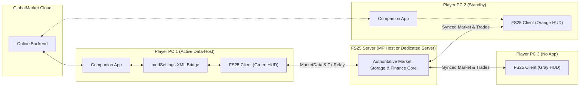

# FS25_GlobalMarket


**Dynamic Global & Simulated Commodity Trading for Farming Simulator 25 — built for Singleplayer, Multiplayer, and Dedicated Servers.**

Developed by **D-S-Agrarservice [Floowy]**.

---

## Table of Contents

- [Overview](#overview)
- [Key Features](#key-features)
- [Architecture & Multiplayer Topology](#architecture--multiplayer-topology)
- [HUD Status Indicator](#hud-status-indicator)
- [Installation & Controls](#installation--controls)
- [Modder & Mapper API (`gm_customs.xml` & Placeables)](#modder--mapper-api-gm_customsxml--placeables)
- [Project Structure](#project-structure)
- [Contributing & Support](#contributing--support)
- [Copyright & License](#copyright--license)

---

## Overview

**FS25_GlobalMarket** adds a full-featured commodity exchange directly into the Farming Simulator 25 `ESC` menu. It automatically detects standard GIANTS silos, production storages, and pallet/bale warehouses on your farm, allowing you to buy and sell bulk crops, liquids, pallets, BigBags, IBC tanks, and bales from one central trading terminal.

GlobalMarket operates seamlessly in two modes:

1. **Simulated Offline Market (Out of the Box):** Works completely standalone without any external software. An internal market simulation dynamically adjusts stock levels, saturation prices, and Great Demand events based on your map's economy.
2. **Live Global Online Market (Optional Companion App):** By running the optional **GlobalMarket Companion Client** alongside the game, your session connects to a shared worldwide market where real player trades drive global supply, price trends, and Great Demand events across servers.

---

## Key Features

### Economy & Fair Cross-Map Pricing
* **Anti-Arbitrage "Map Spy" Pricing:** The online backend never enforces flat euro prices. Instead, the server evaluates the genuine local base price across your map's selling stations (respecting economic difficulty and seasonal factors) and multiplies it by the global market trend (`Local Normal Price × Trend`).
* **Dynamic Supply & Demand:** High market stock lowers prices (down to `-30%`), while scarce stock drives prices up (up to `+30%` and beyond during Great Demands).
* **Great Demand Events:** Configurable scarcity-based or random Great Demands in Offline Mode, and authoritative worldwide Great Demand campaigns in Online Mode — announced directly via native FS25 HUD notifications.
* **Hybrid Moderation Mode (Custom Map/Mod Goods):** Dynamically discovers all `FillTypes` registered by your map and active mods. Officially approved goods trade live on the global online network, while newly discovered (`Pending | Offline`) or local-only (`Offline Only`) custom goods continue running seamlessly in the local offline simulation without interrupting gameplay.

### Storage, Packaging & Logistics
* **Automatic Storage Detection:** Supports standard GIANTS Bulk Silos (`spec_silo`), Production Storages, and Object Storages (`spec_objectStorage`) for pallets and bales.
* **Deep Packaging Resolution:** Buy and sell loose liters or physical containers (Pallets, BigBags, BigBag Pallets, IBC Tanks, Round Bales, and Square Bales). Actively fermenting silage bales are safely excluded from trading until fermentation completes.
* **GM Logistics Terminals (`isGmMarket`):** Optional dedicated logistics buildings with strict multi-farm stock isolation on multiplayer servers, `0 €` delivery fees (physical self-delivery/pickup), configurable daily storage fees, and optional storage expiration/decay warnings (`24h / 12h / 6h / 1h` prior to expiration).

### Native FS25 UI, Finances & Administration
* **Native `InGameMenu` Integration:** Cleanly injected tab in the FS25 `ESC` menu with live search filtering, 3 switchable category layouts (*Detailed*, *Compact*, *Flat A–Z*), trend arrows, and transparent cost breakdowns (base value, dealer markup, and delivery fees).
* **Dedicated Server Ready (Zero Server-Side `.exe` Required):** Uses a dynamic **Data-Host Token & Standby Failover** system so Dedicated Servers can participate in the live Online Market as soon as at least one connected player runs the Companion Client on their PC.
* **Environment-Aware Admin Settings:** Automatically maintains separate configuration profiles for Singleplayer (`sp`), Hosted Multiplayer (`mp`), and Dedicated Servers (`dedi`), configurable live from the FS25 Game Settings tab.
* **Finance Ledger Integration:** Registers dedicated `MoneyType` categories (simple or detailed view) in the native FS25 Finances screen.

---

## Architecture & Multiplayer Topology

Because the GIANTS Engine Lua sandbox restricts direct external network sockets, online communication uses an asynchronous, atomic XML bridge inside `modSettings/FS25_GlobalMarket/` combined with authoritative FS25 multiplayer events:



* **Automatic Token Failover:** If the active Data-Host disconnects or closes their Companion App, the server seamlessly reassigns the Data-Host Token to the next connected Standby client — or falls back cleanly to the simulated Offline Market without losing farm or storage data.
* **Server-Wide Rate Limiting:** Online transactions are authoritatively validated on the FS25 server with a global `15s` online sync cooldown to keep worldwide stock deltas consistent.

---

## HUD Status Indicator

When enabled in the settings, a compact status icon next to the top-right HUD info bar indicates your current connection state:

| Icon Color | Meaning |
| :--- | :--- |
| **Green** | Companion App is running, connected to the backend, and your client is the active **Data-Host**. |
| **Orange** | Companion App is running and connected, standing by for **automatic failover** while another player holds the Data-Host Token. |
| **Red** | Companion App is running locally, but currently has **no connection** to the online backend. |
| **Gray** | **Offline Mode** (no local Companion App active, or standard MP client trading via another player's Data-Host). |
| *Pulsing* | Brief 2-second pulse whenever a fresh online market data packet is synchronized. |

---

## Installation & Controls

### Installation
1. Download the latest `FS25_GlobalMarket.zip` from the official release channel (ModHub / GitHub Releases) and place it into your Farming Simulator 25 `mods` folder.
2. *(Optional – Online Mode)* Download and launch the **GlobalMarket Companion Client** available via the **D-S-Agrarservice Discord**. Once running, GlobalMarket automatically detects the heartbeat and switches your session to the live Online Market.

### Default Controls

| Action | Keyboard / Mouse | Gamepad |
| :--- | :--- | :--- |
| **Open / Close GlobalMarket Menu** | `Left Alt + M` *(or via `ESC` Menu Tab)* | `ESC` Menu Paging |
| **Switch Category View** *(Detailed / Compact / A–Z)* | `C` | `X` *(Menu Extra 1)* |

*(All keybindings can be customized in the standard FS25 Controls menu.)*

---

## Modder & Mapper API (`gm_customs.xml` & Placeables)

GlobalMarket automatically discovers custom `FillTypes`, pallets, BigBags, and bales out of the box. For map authors, modders, and server admins who need fine-grained control over hidden `FillTypes`, liquid classifications, UI categories, or allowed container formats, GlobalMarket provides a zero-script XML API.

**3-Tier Loading Priority:**
1. **Basegame Defaults** (`GlobalMarketAPI.lua`)
2. **External Active Mods** (`gm_customs.xml` placed in the root directory of any active map or mod)
3. **Player / Server Fallback** (`modSettings/FS25_GlobalMarket/gm_fallback.xml` — fills gaps without overriding modder rules)

<details>
<summary><strong>Click to expand: <code>gm_customs.xml</code> / <code>gm_fallback.xml</code> Schema & Example</strong></summary>

Create a `gm_customs.xml` file in the root folder of your mod/map (next to your `modDesc.xml`):

```xml
<?xml version="1.0" encoding="utf-8" standalone="no"?>
<globalMarket>
    <!-- 1. Register custom FillTypeCategories that should be treated and billed as Liquids -->
    <finance>
        <liquidCategories>
            <category name="CUSTOM_LIQUID_CATEGORY" />
        </liquidCategories>
    </finance>

    <marketRegistration>
        <!-- 2. Whitelist: Force FillTypes onto the market even if showOnPriceTable="false" -->
        <!-- Optional attributes:
             category:        GRAINS | ROOTS | FORAGE | SUPPLIES | ANIMAL | PALLETS | OTHER
             compactCategory: CROPS_BULK | BALES_FORAGE | LIQUIDS | PALLETS_PRODUCTS -->
        <whitelist>
            <fillType name="LUPROSIL" category="SUPPLIES" compactCategory="LIQUIDS" />
            <fillType name="CUSTOM_SILAGE_ADDITIVE" category="SUPPLIES" compactCategory="PALLETS_PRODUCTS" />
        </whitelist>

        <!-- 3. UI Category Overrides: Recategorize FillTypes that already appear on the market -->
        <uiCategories>
            <fillType name="SPELT" category="GRAINS" compactCategory="CROPS_BULK" />
        </uiCategories>

        <!-- 4. Blacklist: Strictly exclude internal/technical FillTypes from GlobalMarket -->
        <blacklist>
            <fillType name="INTERNAL_DUMMY_FILLTYPE" />
        </blacklist>

        <!-- 5. Container Restrictions: Restrict specific FillTypes to allowed packaging unitKeys -->
        <!-- Supported unitKeys: ui_gm_unit_pallet, ui_gm_unit_bigbag, ui_gm_unit_bigbagpallet, ui_gm_unit_ibc -->
        <containerRestrictions>
            <restriction fillType="LUPROSIL">
                <allow unitKey="ui_gm_unit_ibc" />
                <allow unitKey="ui_gm_unit_pallet" />
            </restriction>
        </containerRestrictions>
    </marketRegistration>
</globalMarket>
```

</details>

<details>
<summary><strong>Click to expand: Creating Dedicated GM Logistics Buildings (<code>isGmMarket="true"</code>)</strong></summary>

Placeable modders can turn custom silos or object storages into official **GlobalMarket Terminals** (enabling `0 €` delivery costs, multi-farm isolated storage arrays on multiplayer servers, and GM storage fee/decay mechanics) simply by adding `isGmMarket="true"` in the placeable XML — no custom Lua specialization required:

```xml
<!-- For Bulk / Liquid Silos -->
<placeable ...>
    <silo isGmMarket="true" playerActionTrigger="..." ...>
        ...
    </silo>
</placeable>

<!-- For Pallet / Bale Object Storages -->
<placeable ...>
    <objectStorage isGmMarket="true" supportsBales="true" supportsPallets="true" ...>
        ...
    </objectStorage>
</placeable>
```

</details>

---

## Project Structure

```text
FS25_GlobalMarket/
├── GlobalMarket.lua          # Lean lifecycle orchestrator, InGameMenu injection & input bindings
├── modDesc.xml               # FS25 mod descriptor (descVersion 115)
├── events/                   # 14 dedicated Multiplayer synchronization & transaction events
├── gui/                      # GlobalMarketUI & GlobalMarketDialog controllers, XML layouts & profiles
├── images/                   # Menu & UI texture assets (.dds)
├── modules/                  # Specialized domain modules (< 1,000 lines per module):
│   ├── GlobalMarketAPI.lua                   # 3-Tier whitelist/blacklist/category & metadata API
│   ├── GlobalMarketAccess.lua                # Multi-farm access & isolation hooks for GM Terminals
│   ├── GlobalMarketCompatibilityManager.lua  # Dynamic mod conflict firewall & mitigation rules
│   ├── GlobalMarketDebug.lua                 # Leveled logger with round-robin dump rotation
│   ├── GlobalMarketFinance.lua               # Unconditional MoneyType registration & ledger routing
│   ├── GlobalMarketOffline.lua               # Map-Spy pricing, local NPC simulation & Great Demands
│   ├── GlobalMarketOnline.lua                # Online trend pricing & authoritative Great Demand sync
│   ├── GlobalMarketSavegame.lua              # Savegame persistence for market stock & GM Terminals
│   ├── GlobalMarketSettings.lua              # Environment-aware (sp/mp/dedi) settings injection
│   ├── GlobalMarketStorage.lua               # Silo/ObjectStorage transfers, storage fees & decay
│   ├── GlobalMarketStoreCache.lua            # 2-phase deep XML scanner for pallets, BigBags & IBCs
│   └── GlobalMarketSync.lua                  # Companion App XML bridge, token failover & HUD icon
└── translations/             # Localized strings (DE, EN, ES, FR, PL)
```

---

## Contributing & Support

* **Bug Reports & Feature Requests:** Please open an Issue in this GitHub repository and attach your FS25 `log.txt` (and steps to reproduce in Singleplayer vs. Multiplayer/Dedicated Server).
* **Pull Requests:** Clean, focused Pull Requests are welcome! Please keep individual Lua modules modular (`< 1,000` lines), maintain English code comments, and ensure full Multiplayer stream symmetry.
* **Community & Companion App:** Join the **D-S-Agrarservice Discord** for news, online market events, and the optional GlobalMarket Companion Client download.

---

## Copyright & License

**Copyright © D-S-Agrarservice [Floowy]. All Rights Reserved.**

* **No Unauthorized Re-Uploads:** Uploading this mod (in whole or in part) to third-party mod hosting websites, file-sharing paywalls, or unauthorized mirrors is **strictly prohibited**. Please always link to the official release channels (GIANTS ModHub / official GitHub Releases).
* **No Redistribution of Modified Versions:** Creating and publicly distributing modified, rebranded, or repackaged versions of `FS25_GlobalMarket` without prior written permission from the author is not permitted.
* **Modder Compatibility:** Using the documented `gm_customs.xml` interface or `isGmMarket="true"` XML attribute inside your own maps and placeable mods is explicitly encouraged and requires no special permission!
